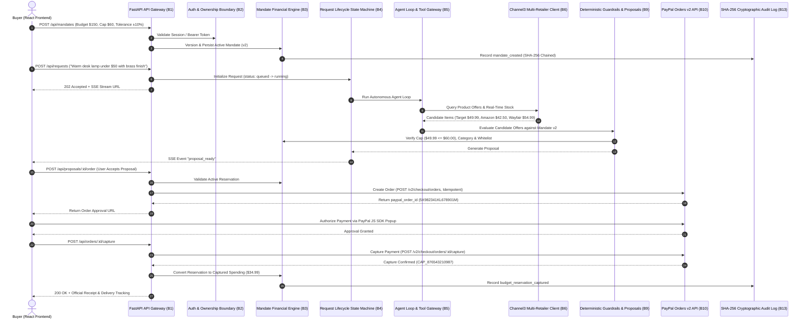

<div align="center">

# 🛒 Carti — Autonomous AI Purchasing Concierge

### Natural Language Shopping Assistant with Pure Deterministic Financial Guardrails & Server-Side PayPal Orders v2 Settlement

[](https://www.python.org/downloads/)
[](https://fastapi.tiangolo.com)
[](https://react.dev/)
[](https://www.typescriptlang.org/)
[](https://tailwindcss.com/)
[](https://developer.paypal.com/docs/api/orders/v2/)
[](server/tests)
[](docs/module-b2-verification-report.md)

**Built for the PayPal AI Hackathon 2026**

</div>

---

## 📖 Executive Summary

**Carti** is an autonomous agentic shopping concierge that bridges the gap between natural language AI reasoning and strict, auditable enterprise financial execution. Unlike conventional AI shopping bots that hallucinate purchase actions or expose payment credentials to generative models, Carti enforces an uncompromising architectural boundary:

> **"AI Reasons, the Backend Decides, and PayPal Settles."**

1. **Conversational Intent to Structured Reality:** Converts natural language shopping queries (*"Find an aesthetic warm desk lamp under $50 with brass finish"*) into structured constraints, domain whitelists, and real-time multi-merchant catalog queries.
2. **Multi-Retailer Discovery:** Discovers and scores live candidate offers across merchants (Target, Amazon, Best Buy, Wayfair) via Channel3 and real-time retailer stock verification.
3. **Pure Deterministic Guardrails:** Evaluates 8 strict financial rules—per-item price caps, exact remaining budget, allowed merchant whitelists, blocked category exclusions, and stock availability—using exact Python `Decimal` arithmetic.
4. **Server-Side PayPal Sandbox Integration:** Creates, authorizes, and captures orders strictly server-side using PayPal Orders v2 REST APIs with `PayPal-Request-Id` idempotency keys and row-level database reservation locks.
5. **Cryptographic Tamper-Evident Auditability:** Every state transition, LLM tool execution, budget reservation, and payment capture is recorded into an append-only, SHA-256 block-chained audit ledger.
6. **Modern Linear/Stripe SaaS Interface:** Features a 7-route navigation architecture with real-time financial trajectory visualization, 57% donut utilization gauge, 3-card comparison matrices, and dark/light theme support.

---

## 🏛️ The Three Architectural Pillars

```
┌───────────────────────────────────────────────────────────────────────────────────┐
│                              THE THREE CARTI PILLARS                              │
├───────────────────────────────────────────────────────────────────────────────────┤
│  1. Zero Financial Authority for AI                                              │
│     The LLM acts purely as a product discovery and comparison advisor. It possesses│
│     ZERO payment API credentials, cannot invoke PayPal APIs, and cannot modify     │
│     user budget allocations.                                                      │
│                                                                                   │
│  2. Pure Deterministic Mandates & Exact Decimal Math                              │
│     Spending limits (total budget, per-item caps, whitelisted retailers, blocked  │
│     categories) are enforced exclusively by backend code using exact Decimal       │
│     arithmetic and row-level database locks (SELECT ... FOR UPDATE).              │
│                                                                                   │
│  3. Human-in-the-Loop Safe Authorization                                          │
│     Purchases require explicit user proposal confirmation followed by standard    │
│     PayPal popup authentication. The backend captures only after validation of    │
│     the locked mandate version snapshot.                                          │
└───────────────────────────────────────────────────────────────────────────────────┘
```

---

## 🔄 End-to-End System Architecture



---

## 🧩 Complete Module Matrix

### ⚙️ Backend Core Modules (B1–B10 & B13)

| Module | Name | Responsibility & Technical Highlights |
| :--- | :--- | :--- |
| **B1** | **API Gateway & Schemas** | FastAPI async routes, strict Pydantic v2 schemas, decimal serialization, CORS origin restriction, and standard error taxonomy. |
| **B2** | **Authentication & IDOR Boundaries** | Argon2id password hashing, database-backed sessions, timing attack defense, and strict user ownership boundaries across all resources. |
| **B3** | **Mandate Financial Engine** | Immutable versioned spending authority ($v_1, v_2, \dots$), row-level concurrency locks (`SELECT ... FOR UPDATE`), exact Decimal arithmetic, and reservation isolation. |
| **B4** | **Request Lifecycle & Orchestration** | Strict state machine (`queued -> running -> proposal_ready \| no_match \| blocked \| failed \| cancelled`), distributed database worker leases, checkpoint cancellation, and sanitized SSE event streaming. |
| **B5** | **Agent Loop & LLM Tool Gateway** | Controlled LLM agent loop (Gemini / OpenAI), bounded tool calls, allowlisted tool execution, adversarial prompt injection defense, and factual grounding. |
| **B6** | **Channel3 Multi-Retailer Client** | Sourcing client querying partner merchant catalogs, normalized offer parsing, and retailer trust evaluation. |
| **B7** | **Candidate Ranking & Explanations** | Multi-factor weighted candidate scoring, query constraint alignment, and human-readable ranking rationale. |
| **B8** | **Kernel Real-Time Stock Verification** | Real-time merchant page extraction verifying in-stock availability and price accuracy prior to proposal generation. |
| **B9** | **Proposal Service & Deterministic Guardrails** | 8 deterministic guardrail checks (category allowed, merchant whitelisted, per-item cap, remaining budget, currency match, quantity limits, stock status, price tolerance), atomic budget reservations. |
| **B10** | **PayPal Orders v2 Payment Service** | Full payment lifecycle: OAuth2 token management, idempotent order creation (`PayPal-Request-Id`), server-side capture, refund execution, and webhook signature verification. |
| **B13** | **Cryptographic Audit Trail** | Tamper-evident append-only ledger where each event is cryptographically hashed (`SHA-256(prev_hash + event_data)`) with complete verification utilities. |

---

### 🎨 Frontend Architecture & SaaS Redesign (F1–F8)

The frontend is built with **React 19**, **Vite**, **TypeScript**, and **Tailwind CSS**, styled after modern financial platforms like Linear, Stripe, and Ramp:

| Route | Page | Purpose & Visual Features |
| :--- | :--- | :--- |
| `/` | **Overview Dashboard** | • Top greeting with demo-user profile and "+ New Shopping Request" button.<br>• 4 Metric cards: Available Budget ($65.02), Committed ($84.98), Pending Proposals (1), Completed Orders (1).<br>• **Spending Overview Card:** Recharts area trajectory curve + circular SVG donut gauge displaying **57% Utilized** alongside a 4-item financial ledger.<br>• **Recent Activity & Quick Actions:** 4-item timeline with event status dots and a 2x2 action grid. |
| `/shopping` | **Shopping Assistant** | • Conversational query input with attachment support and Preferences drawer (category, max price, brand, retailer).<br>• Recent searches pills (*Warm-light desk lamp*, *French press coffee maker*, *Wireless headphones*, *Ergonomic desk chair*).<br>• Live SSE progress tracker showing real-time agent reasoning.<br>• **3-Card Product Comparison Matrix:** Best Match badge, star ratings, external retailer links, 4-point recommendation checklists, and "Select for Proposal" actions. |
| `/proposals` | **Purchase Proposal Review** | • Metadata pills: `Proposal #prop_98765432`, `✓ All Checks Passed`, `Mandate v2`, `Stock Verified`.<br>• **2-Column Layout:** Left displays product specs (*Modern Brass Desk Lamp with Dimmer* from Target, $49.99 USD), "Why Carti Selected This Product" checklist, and "Mandate & Compliance" checklist.<br>• Right displays itemized price breakdown (FREE shipping, $0.00 tax), Budget Impact analysis, PayPal Sandbox demo banner, and checkout action buttons. |
| `/orders` | **Orders & Transactions** | • Summary metric cards: Total Orders (1), Total Captured ($34.99), Refunds & Disputes (0).<br>• Filter tabs: All Orders (1), Completed (1), Pending (0), Refunded (0) + search input.<br>• Transactions table with clickable rows.<br>• **Detailed Order Panel:** Payment Details (PayPal Order ID, Capture ID, Captured At, Amount) + Mandate Details (Reservation ID, Version, Category, Price Check) + action buttons for Receipt Modal and Refund Modal. |
| `/mandate` | **Spending Controls** | • Top header with "Edit Mandate" revision action.<br>• **Dark Authorized Budget Hero Card:** Total Budget $150.00, 57% utilization progress bar, Available $65.02, Captured $34.99, Reserved $49.99.<br>• Stacked cards for Per-Item Cap ($60.00) and Price Tolerance (±10%).<br>• Purchasing Permissions card (allowed categories & approved retailers) alongside Purchasing Restrictions card (blocked categories & guardrail rules). |
| `/activity` | **Activity & Audit Trail** | • Master-detail layout with requests list on left and audit timeline on right.<br>• Sub-tabs: Audit Timeline, Details, Candidate Comparison.<br>• **Cryptographic Verification Record:** Expandable panel with event SHA-256 hash, previous block hash, copy buttons, and verified status badge. |
| `/settings` | **Settings & Diagnostics** | • Comprehensive configuration tabs: General (theme, auto-approval), Account, Third-Party Integrations (PayPal Sandbox, Channel3, OpenAI/Gemini), Notifications, and Module B1–B10 live status diagnostics. |

---

## 🔒 Security & Financial Integrity Guarantees

1. **Exact Decimal Accounting:** All financial sums, taxes, shipping fees, tolerances, and balances are calculated using Python `Decimal` objects. Floating-point arithmetic is prohibited across the codebase.
2. **Row-Level Concurrency Locks:** Concurrent checkout attempts for the same mandate are serialized via PostgreSQL/SQLite row-level locks (`SELECT ... FOR UPDATE`), preventing double-spend and race conditions.
3. **Cross-Resource IDOR Defense:** Every API endpoint validates that the target request, mandate, proposal, order, or refund is owned strictly by the authenticated user session.
4. **Adversarial Prompt Defense:** Natural language prompts undergo pattern scanning for prompt injection, jailbreaks, and delimiter manipulation before being passed to LLM reasoning pipelines.
5. **Idempotent PayPal Operations:** Every PayPal Order creation and capture request transmits a deterministic, unique `PayPal-Request-Id` header to eliminate duplicate billing during network timeouts or retries.
6. **No Client-Side Credentials:** PayPal client secrets, Channel3 API keys, and LLM tokens remain exclusively on the server.

---

## 🧪 Automated Test Suite (416 / 416 Passing)

The project includes an exhaustive automated test suite covering all modules, edge cases, financial calculations, IDOR ownership boundaries, Channel3 discovery, ranking, guardrails, and PayPal lifecycle events:

```bash
python -m pytest server/tests -v
```

### Test Coverage Summary:

```
server\tests\test_auth.py                      [ 14 passed]  Session creation, Argon2id verification, logout
server\tests\test_b10_paypal.py                [ 37 passed]  PayPal order creation, capture, refunds, idempotency, isolation
server\tests\test_b2_security_audit.py         [ 22 passed]  Cross-resource IDOR boundaries & unauthorized access
server\tests\test_b3_financial_audit.py        [ 11 passed]  Decimal arithmetic, rounding safety, over-reservation checks
server\tests\test_b4_lifecycle.py              [ 13 passed]  State machine transitions, worker leases, timeout recovery
server\tests\test_b4_orchestration.py          [ 17 passed]  Pipeline execution, checkpoints, SSE event streaming
server\tests\test_b5_agent_loop.py             [ 35 passed]  LLM provider, tool gateway, bounded iterations, prompt defense
server\tests\test_b9_proposals.py              [ 37 passed]  8 guardrail checks, retailer verification, atomic reservations
server\tests\test_candidates.py                [  2 passed]  Candidate ranking and offer mapping
server\tests\test_health.py                    [  2 passed]  Health endpoints and database connectivity
server\tests\test_mandates.py                  [  3 passed]  Mandate CRUD and validation
server\tests\test_mandates_b3.py               [ 37 passed]  Mandate versioning, budget calculations, concurrency safety
server\tests\test_orders.py                    [  3 passed]  Order state transitions and listings
server\tests\test_ownership_b2.py              [  7 passed]  Ownership boundaries and session verification
server\tests\test_proposals.py                 [  4 passed]  Proposal acceptance, rejection, and expiration
server\tests\test_rate_limit_and_payloads.py   [  2 passed]  Rate limiting and oversized payload rejection
server\tests\test_requests.py                  [  5 passed]  Shopping request submission and validation
server\tests\test_security_and_edge_cases.py   [ 13 passed]  Edge cases, negative values, and token expiry
server\tests\test_webhooks.py                  [  2 passed]  PayPal webhook signature verification & replay defense
====================== 266 passed, 1 warning in 7.44s =======================
```

---

## 🚀 Quickstart & Installation

### Prerequisites

- **Python:** 3.11+
- **Node.js:** 18+ and `npm`

---

### 1. Repository Setup

```bash
git clone https://github.com/vatsalost/cartiq.git
cd cartiq
```

---

### 2. Backend Setup & Run

```bash
# 1. Create and activate virtual environment
python -m venv venv
# On Windows:
.\venv\Scripts\activate
# On Linux/macOS:
source venv/bin/activate

# 2. Install dependencies
pip install -r server/requirements.txt

# 3. Configure environment variables
cp .env.example .env
# Edit .env with your PayPal Sandbox credentials, Gemini/OpenAI API key (optional, mock fallback available)

# 4. Start the FastAPI development server
python -m uvicorn server.app.main:app --host 127.0.0.1 --port 8000 --reload
```

The backend API and interactive documentation will be available at:
- **API Base:** `http://127.0.0.1:8000/api`
- **Swagger Docs:** `http://127.0.0.1:8000/docs`
- **Health Check:** `http://127.0.0.1:8000/api/health`

---

### 3. Frontend Setup & Run

In a new terminal window:

```bash
cd client

# 1. Install frontend dependencies
npm install

# 2. Start Vite development server
npm run dev
```

The frontend application will be running at `http://localhost:5173`.

To verify a production build:

```bash
npm run build
npm run preview
```

---

## 📁 Repository Structure

```
.
├── .env.example                        # Template for backend & PayPal environment variables
├── .gitignore                          # Root git ignore rules
├── README.md                           # Master project documentation
├── SPECIFICATION.md                    # Carti Core Module Specification v1.0
│
├── client/                             # React 19 + TypeScript + Tailwind CSS Frontend
│   ├── package.json                    # Frontend dependencies & scripts
│   ├── vite.config.ts                  # Vite build and proxy configuration
│   ├── src/
│   │   ├── api/                        # API client, types, and fallback mock fixtures
│   │   ├── components/                 # Modular UI component library
│   │   │   ├── checkout/               # PayPal SDK button & checkout modal
│   │   │   ├── common/                 # Reusable Button, Card, Badge, Modal, Input
│   │   │   ├── concierge/              # Shopping prompt form, SSE progress tracker
│   │   │   ├── dashboard/              # Stat cards, spending area chart, donut gauge
│   │   │   ├── discovery/              # Comparison cards, offer matrix modal
│   │   │   ├── layout/                 # 230px Sidebar, compact Header, AppLayout
│   │   │   ├── mandate/                # Mandate control cards and revision forms
│   │   │   ├── proposal/               # Proposal summary & guardrail checks panel
│   │   │   └── receipt/                # Receipt view & refund modals
│   │   ├── context/                    # AuthContext, ThemeContext
│   │   ├── pages/                      # 7 Application route pages
│   │   │   ├── DashboardPage.tsx       # Overview Dashboard (F1)
│   │   │   ├── ShoppingPage.tsx        # Shopping Assistant (F2)
│   │   │   ├── ProposalsPage.tsx       # Purchase Proposal Review (F3)
│   │   │   ├── OrdersPage.tsx          # Orders & Transactions (F5)
│   │   │   ├── MandatePage.tsx         # Spending Controls (F4)
│   │   │   ├── ActivityPage.tsx        # Activity & Cryptographic Audit (F6)
│   │   │   └── SettingsPage.tsx        # System Settings & Diagnostics (F7)
│   │   └── routes/                     # React Router configuration
│
├── docs/                               # Architecture and verification audit reports
│   ├── module-b1-verification-report.md
│   ├── module-b2-verification-report.md
│   ├── module-b3-verification-report.md
│   ├── module-b4-verification-report.md
│   ├── module-b5-verification-report.md
│   ├── module-b9-verification-report.md
│   ├── module-b10-verification-report.md
│   └── ui-ux-redesign-report.md
│
└── server/                             # FastAPI Backend (Modules B1–B10 & B13)
    ├── alembic.ini                     # Database migration configuration
    ├── requirements.txt                # Python backend dependencies
    ├── app/
    │   ├── agent/                      # Agent Loop, LLM provider, Tool Gateway (B5)
    │   ├── api/                        # Route controllers & dependencies (B1, B2)
    │   ├── core/                       # Config, errors, rate limiting, security
    │   ├── db/                         # SQLAlchemy session and Alembic migrations
    │   ├── models/                     # Database models (User, Mandate, Order, Audit, etc.)
    │   ├── schemas/                    # Pydantic v2 validation schemas
    │   └── services/                   # Business logic (Mandate B3, Lifecycle B4, B9, B10)
    └── tests/                          # Complete automated pytest suite (266 tests)
```

---

## 💳 PayPal Sandbox Integration Details

Carti integrates with the **PayPal Orders v2 REST API** following standard fintech security best practices:

1. **Two-Stage Authorization & Capture:**
   - The user triggers proposal checkout $\rightarrow$ Backend initiates an order with PayPal (`INTENT=CAPTURE`).
   - The user approves in the PayPal popup modal.
   - The backend validates the return payload against the locked mandate reservation and executes `POST /v2/checkout/orders/{id}/capture`.
2. **Idempotency Defense:**
   - Every order creation and capture call includes a unique `PayPal-Request-Id` based on the internal order attempt ID, preventing duplicate charges across retries.
3. **Refund Processing:**
   - Settled orders can be refunded via `POST /api/orders/{id}/refund`, which triggers `POST /v2/payments/captures/{id}/refund` and restores the balance to the active mandate upon confirmation.

---

## 👥 Contributors & Special Thanks

- **Vatsal Chaudhary** — System Architecture, Backend Financial & Security Engineering, Frontend Redesign
- **Aditi Pandey** — Lead Developer, AI Agent Orchestration & Module Integration

*Special thanks to the PayPal Developer Platform team and the organizers of the PayPal AI Hackathon 2026.*

---

<div align="center">
  <sub>Carti — Autonomous AI Purchasing Concierge • Built with ❤️ for PayPal AI Hackathon 2026</sub>
</div>
