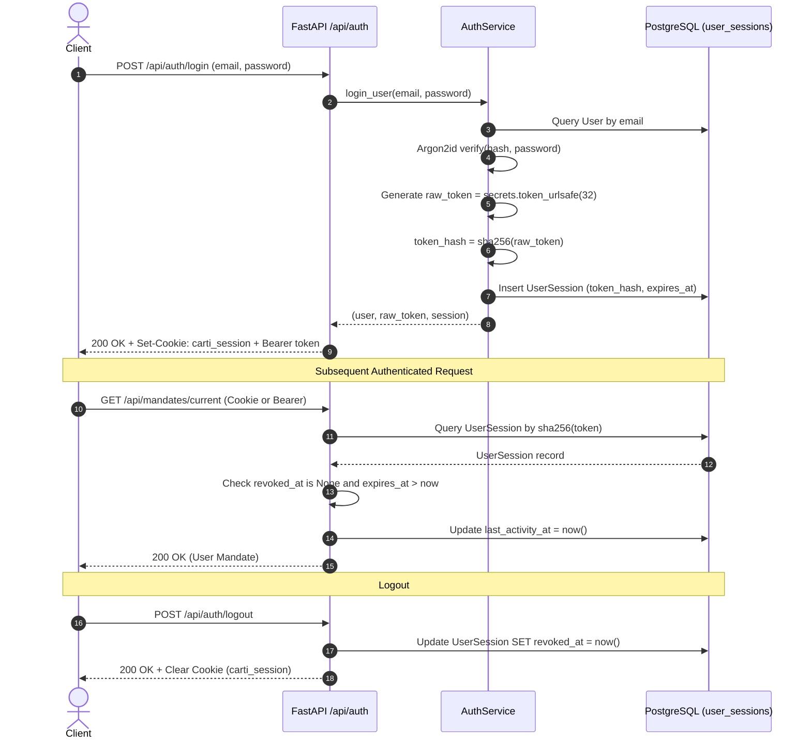

# Carti — Authentication and User Ownership Boundary (Module B2)

This document provides a comprehensive architectural and operational specification for **Backend Module B2: Authentication and User Ownership Boundary** in the Carti Agentic Shopping Concierge platform (PayPal AI Hackathon 2026).

---

## 1. Architectural Overview

Carti enforces strict user data isolation and authorization boundaries across all resource models:
- **Spending Mandates**
- **Shopping Requests & SSE Event Streams**
- **Product Candidates & Offers**
- **Purchase Proposals**
- **PayPal Orders & Payment Captures**
- **Refunds & Reconciliations**
- **Audit Logs**

### Key Security Principles
1. **Never Trust Client Identifiers**: The backend never accepts `user_id` from request bodies or URL paths to determine actor identity. The actor identity is strictly resolved from validated session credentials on the server.
2. **Hashed Session Tokens in Database**: Raw session tokens (`token_urlsafe(32)`) are only transmitted to the client and never stored in plaintext. The database exclusively stores `SHA-256(raw_token)`, preventing credential hijacking even in the event of a database leak.
3. **Argon2id Password Hashing**: Passwords are hashed using the Argon2id standard (`argon2-cffi`), memory-hardened against GPU and ASIC cracking attacks.
4. **Dual Transport Support**: Authentication supports both HTTP-only, SameSite session cookies (`carti_session`) and `Authorization: Bearer <token>` headers, accommodating browser clients, mobile apps, and automated test runners.
5. **Constant-Time Verification Against User Enumeration**: When a non-existent email is queried during login, a dummy Argon2id hash is verified to maintain consistent execution latency and prevent user enumeration timing attacks.
6. **Strict Dev/Demo Mode Isolation**: Demo bypasses and demo login are strictly forbidden when `APP_ENV=production`. In production, only verified accounts and valid sessions can access protected endpoints.
7. **Cross-Resource Integrity Defense**: Resource access verifies not only the root entity's owner, but also verifies that related foreign resources (e.g. proposal's linked mandate and shopping request) belong to the identical user.

---

## 2. Session Lifecycle & Token Management



### Session Attributes
| Field | Type | Description |
|---|---|---|
| `id` | UUID | Primary key |
| `user_id` | UUID (FK) | References `users.id` (ON DELETE CASCADE) |
| `token_hash` | String(64) | SHA-256 hash of the 32-byte URL-safe token (Indexed, Unique) |
| `created_at` | DateTime(UTC) | Session issuance timestamp |
| `expires_at` | DateTime(UTC) | Session expiration timestamp (default: 7 days) |
| `revoked_at` | DateTime(UTC) | Nullable timestamp set upon logout |
| `last_activity_at` | DateTime(UTC) | Updated on each authenticated request |
| `ip_address` | String(45) | Client IPv4 or IPv6 address |
| `user_agent` | String(512) | Sanitized Client User-Agent header |

---

## 3. Cookie Specifications

When authentication succeeds (`/api/auth/register`, `/api/auth/login`, `/api/auth/demo`), the response header includes:

```http
Set-Cookie: carti_session=<raw_token>; Max-Age=604800; Path=/; Expires=Mon, 10 Nov 2026 12:00:00 GMT; HttpOnly; SameSite=Lax
```

- **`HttpOnly`**: True (prevents JavaScript access, mitigating XSS session theft).
- **`SameSite`**: Lax (prevents CSRF while allowing top-level navigation).
- **`Secure`**: Enabled in production (`APP_ENV=production`), requiring HTTPS.
- **`Path`**: `/`

---

## 4. API Endpoints Reference

### A. Register Account
`POST /api/auth/register`  
Rate limit: 5 requests / minute

**Request Body:**
```json
{
  "email": "shopper@example.com",
  "password": "SecurePassword123!"
}
```

**Response:** `HTTP 201 Created`
```json
{
  "user": {
    "id": "c1f7b020-0000-0000-0000-000000000001",
    "email": "shopper@example.com",
    "status": "active",
    "is_active": true,
    "authenticated": true
  },
  "token": "7Y2dK9..._urlsafe_32_bytes_token",
  "token_type": "bearer",
  "expires_at": "2026-11-10T23:00:00Z"
}
```

---

### B. Login
`POST /api/auth/login`  
Rate limit: 5 requests / minute

**Request Body:**
```json
{
  "email": "shopper@example.com",
  "password": "SecurePassword123!"
}
```

**Response:** `HTTP 200 OK` (Sets cookie and issues fresh session token)

---

### C. Demo Login (Development Only)
`POST /api/auth/demo`

**Request Body (optional):**
```json
{
  "demo_identifier": "buyer-test-session"
}
```

**Response:** `HTTP 200 OK`  
*Note: Returns `HTTP 403 Forbidden` (`ACCESS_DENIED`) when `APP_ENV=production`.*

---

### D. Logout
`POST /api/auth/logout`

**Response:** `HTTP 200 OK`
```json
{
  "status": "logged_out",
  "message": "Successfully logged out."
}
```
*Revokes session in database and clears the `carti_session` cookie.*

---

### E. Get Current Profile
`GET /api/auth/me`  
Requires active session.

**Response:** `HTTP 200 OK`
```json
{
  "id": "c1f7b020-0000-0000-0000-000000000001",
  "email": "shopper@example.com",
  "status": "active",
  "is_active": true,
  "authenticated": true
}
```

---

### F. Authentication Status
`GET /api/auth/status`  
Public endpoint; does not throw 401 when unauthenticated.

**Response (Unauthenticated):** `HTTP 200 OK`
```json
{
  "authenticated": false,
  "user": null
}
```

**Response (Authenticated):** `HTTP 200 OK`
```json
{
  "authenticated": true,
  "user": { ... }
}
```

---

## 5. User Ownership Boundaries & IDOR Defense

Carti guarantees that no user can read, mutate, or hijack resources belonging to another user.

### Enforcement Matrix
| Endpoint / Resource | Ownership Rule | Failure Status |
|---|---|---|
| `GET /api/mandates/current` | Scoped strictly to `user_id = current_user.id` | 404 if no mandate exists for user |
| `POST /api/mandates` | Bound to `current_user.id` | 401 / 403 |
| `POST /api/requests` | Request, mandate snapshot, and events bound to `current_user.id` | 401 / 403 |
| `GET /api/requests/{id}` | Query checks `id == request_id and user_id == current_user.id` | 403 ACCESS_DENIED |
| `GET /api/requests/{id}/candidates` | Verifies parent request belongs to `current_user.id` | 403 ACCESS_DENIED |
| `GET /api/proposals/{id}` | Verifies `proposal.user_id == current_user.id` and all associated parents | 403 ACCESS_DENIED |
| `POST /api/proposals/{id}/order` | Verifies proposal ownership before initiating PayPal checkout | 403 ACCESS_DENIED |
| `POST /api/orders/{id}/capture` | Verifies `order.user_id == current_user.id` | 403 ACCESS_DENIED |
| `POST /api/orders/{id}/refund` | Verifies `order.user_id == current_user.id` | 403 ACCESS_DENIED |
| `GET /api/orders` | Query filters `Order.user_id == current_user.id` | 200 OK (only user's orders) |
| `GET /api/orders/{id}` | Verifies order and associated proposal ownership | 403 ACCESS_DENIED |

---

## 6. Production Hardening Checklist

- [x] Passwords hashed with Argon2id using recommended memory and iteration cost.
- [x] Database stores only SHA-256 session token hashes, never raw tokens.
- [x] HTTP-only, SameSite=Lax cookie configuration.
- [x] Constant-time dummy verify prevents user enumeration via response timing.
- [x] Sliding-window rate limiter on auth endpoints (max 5 req/min per client).
- [x] Session rotation on login (fresh token generated).
- [x] Session revocation on logout and automatic expiry check.
- [x] Inactive/suspended user rejection.
- [x] Cross-resource association integrity checking.
- [x] Production environment check disallows demo access and demo credentials.
