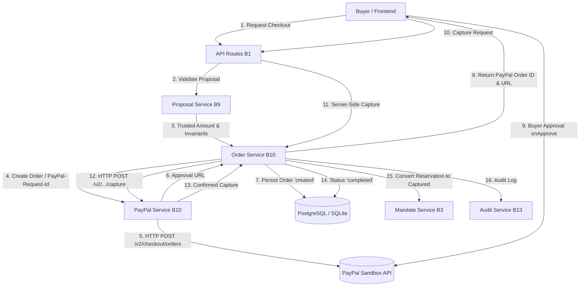

# CARTI — MODULE B10 IMPLEMENTATION REPORT
## PayPal Payment Service and Payment Lifecycle

**Status:** COMPLETE (Definition of Done Met)  
**Date:** November 5, 2026  
**Module:** B10 — PayPal Payment Service and Payment Lifecycle  
**Author:** Senior Backend Engineer, Payment Systems Architect, Application Security Engineer  
**Branch:** `vatsal`  
**Test Suite:** 24 B10 tests passed (253 total backend tests passed, 0 failures)

---

## 1. Executive Summary & Architecture Overview

Module B10 provides the secure payment processing core for Carti, integrating the verified shopping proposal output from B9 with the PayPal Orders v2 and Payments v2 Sandbox APIs. It is responsible for OAuth 2.0 client credentials token acquisition and caching, server-side PayPal order creation, client approval URL generation, buyer approval reconciliation, server-side payment capture, controlled full and partial refunds, monotonic order state management, and B3 mandate budget conversion.



---

## 2. PayPal Sandbox Configuration

Configuration is managed securely via `server/app/core/config.py` using environment variables. Credentials remain strictly isolated on the server and are never exposed in API responses or logs:

| Variable | Type | Default | Description |
|---|---|---|---|
| `PAYPAL_ENV` | String | `"sandbox"` | Environment target (`sandbox` or `live`) |
| `PAYPAL_MODE` | String | `"sandbox"` | Standardized alias for environment target |
| `PAYPAL_BASE_URL` | String | `https://api-m.sandbox.paypal.com` | Verified PayPal Sandbox REST endpoint |
| `PAYPAL_CLIENT_ID` | String | `""` | PayPal Developer REST App client ID |
| `PAYPAL_CLIENT_SECRET` | String | `""` | PayPal Developer REST App client secret |
| `PAYPAL_WEBHOOK_ID` | String | `""` | Registered Webhook ID for signature verification |
| `PAYPAL_TIMEOUT_SECONDS` | Float | `10.0` | Strict HTTP socket and connect timeout |

- **Security Boundary:** The Sandbox base URL is fixed in server configuration and cannot be overridden by user input or LLM generation.
- **Fail-Safe Offline Mode:** If credentials are not supplied (e.g., in offline development and continuous integration), the service safely provides deterministic mock sandbox responses without network dependencies.

---

## 3. PayPal Client Implementation (`PayPalService`)

Located in [`server/app/services/paypal_service.py`](file:///c:/Users/vatsl/Documents/PayPal#BOT/server/app/services/paypal_service.py):

- **OAuth 2.0 Token Caching:** `get_access_token()` requests tokens via HTTP Basic Auth from `/v1/oauth2/token`. Tokens are cached in-memory and refreshed when within 60 seconds of expiration (`_token_expires_at`).
- **Tuple-Compatible Result Object:** `create_order` returns `PayPalCreateOrderResult`, a custom tuple subclass that unpacks as `(paypal_order_id, amount, currency)` for backwards compatibility while exposing `.approval_url` as an attribute.
- **REST v2 Operations:**
  - `create_order(proposal, checkout_attempt_id)`: Generates a stable `PayPal-Request-Id`, invokes `/v2/checkout/orders` with intent `"CAPTURE"`, purchase unit amount, and returns the PayPal order ID and buyer approval URL.
  - `get_order(paypal_order_id)`: Calls `/v2/checkout/orders/{id}` to verify order state.
  - `capture_order(paypal_order_id, idempotency_key)`: Sends idempotent POST to `/v2/checkout/orders/{id}/capture`, validates status is `COMPLETED`, and extracts capture ID and timestamp.
  - `get_capture(capture_id)`: Calls `/v2/payments/captures/{id}` to retrieve capture records.
  - `refund_capture(capture_id, amount, currency, idempotency_key, note_to_payer)`: Issues idempotent refund via `/v2/payments/captures/{id}/refund`.
  - `get_refund(refund_id)`: Calls `/v2/payments/refunds/{id}`.
  - `verify_webhook_signature(...)`: Validates transmission headers and calls `/v1/notifications/verify-webhook-signature`.

---

## 4. Database Models and Persistence

Module B10 utilizes PostgreSQL-compliant models in `server/app/models/`:

### `orders` Table (`Order`)
- `id` (UUID, PK)
- `proposal_id` (UUID, FK `proposals.id`, UNIQUE): Prevents multiple orders for the same proposal.
- `user_id` (UUID, FK `users.id`, Index): Enforces ownership boundaries.
- `paypal_order_id` (String(128), UNIQUE, nullable): External PayPal reference.
- `paypal_capture_id` (String(128), UNIQUE, nullable): Confirmed capture transaction ID.
- `create_request_id` (String(128), UNIQUE): Deduplicates checkout attempts.
- `capture_request_id` (String(128), UNIQUE, nullable): Idempotency key for capture.
- `amount` (Numeric(12, 2)): Authoritative server-calculated amount.
- `currency` (String(3)): ISO currency code (`USD`).
- `status` (String(32), Index): `created`, `buyer_approved`, `completed`, `refunded`, `cancelled`, `failed`.
- `budget_reserved` (Numeric(12, 2)): In-flight budget reservation tracking.
- `captured_at` (DateTime(tz), nullable): Monotonic timestamp of confirmed capture.
- `approval_url` (@property): Generates the buyer approval link.

### `refunds` Table (`Refund`)
- `id` (UUID, PK)
- `order_id` (UUID, FK `orders.id`, Index)
- `paypal_refund_id` (String(128), UNIQUE, nullable)
- `request_idempotency_key` (String(128), UNIQUE): Idempotency token for refund execution.
- `amount` (Numeric(12, 2)): Exact refunded amount.
- `currency` (String(3))
- `status` (String(32)): `completed`, `pending`, `failed`
- `created_at` (DateTime(tz))

---

## 5. Checkout Validation via Module B9

B10 enforces the trusted B9 boundary before creating any internal or PayPal order:
1. `OrderService.create_order_from_proposal` invokes `proposal_service.prepare_proposal_for_checkout(proposal_id, user_id)`.
2. Validates user ownership (`403 ACCESS_DENIED` on IDOR attempt).
3. Verifies proposal status is strictly `pending` (`409 PROPOSAL_STALE` otherwise).
4. Verifies proposal has not expired (`409 PROPOSAL_EXPIRED`).
5. Rechecks active spending mandate (rejects if revoked or expired with `400 MANDATE_INVALID`).
6. Revalidates retailer offer stock and price tolerance.
7. Locks mandate row and confirms available budget $\ge$ `total_amount`.
8. Returns `CheckoutPreparationResult` containing server-calculated `amount` and `currency`.

---

## 6. Order Creation & Idempotency Workflow

1. Receives proposal ID and client-generated `checkout_attempt_id`.
2. Derives stable `create_req_id = sha256(proposal_id + ":" + checkout_attempt_id)[:32]`.
3. If an order already exists for this proposal:
   - If `order.create_request_id == create_req_id`: Idempotently returns existing order.
   - If different attempt ID: Rejects with `PROPOSAL_STALE` (409) preventing duplicate order creation.
4. Calls `paypal_service.create_order` with intent `"CAPTURE"` and stable request ID.
5. Sets `proposal.status = "checkout_started"`.
6. Sets `order.status = "created"`, `order.budget_reserved = amount`.
7. Records audit event `paypal_order_created`.

---

## 7. Server-Side Capture Workflow

1. Triggered via `POST /api/orders/{order_id}/capture` following buyer PayPal approval.
2. Revalidates order ownership (`order.user_id == current_user.id`).
3. Validates order status: Must be `created` or `buyer_approved`. If already `completed`, idempotently returns existing order. If terminal (`refunded`, `cancelled`, `failed`), rejects.
4. Generates stable `capture_key = sha256("cap:" + order.id)[:32]`.
5. Executes capture via `paypal_service.capture_order(order.paypal_order_id, capture_key)`.
6. Validates PayPal capture status is `COMPLETED`.
7. Updates `order.status = "completed"`, `order.paypal_capture_id = capture_id`, `order.captured_at = captured_at`.
8. Updates associated proposal: `proposal.status = "ordered"`.
9. B3 Accounting: Calls `mandate_service.convert_reservation_to_captured(order.id)`.
10. Records audit event `payment_captured`.

---

## 8. Refund Workflow (Full and Partial)

1. Triggered via `POST /api/orders/{order_id}/refund`.
2. Revalidates order ownership.
3. Order must be in `completed` status with an existing `paypal_capture_id`.
4. Calculates remaining refundable balance: `remaining = order.amount - sum(completed_refunds)`.
5. Validates requested refund amount: `0.00 < amount <= remaining`.
6. Generates stable idempotency key: `ref_key = sha256("ref:" + order.id + ":" + amount)[:32]`.
7. If existing completed refund matches `ref_key`, returns idempotently.
8. Invokes `paypal_service.refund_capture`.
9. Persists `Refund` record.
10. If cumulative refunds equal total order amount, transitions `order.status = "refunded"` and resets `order.budget_reserved = 0.00`.
11. Records audit event `order_refunded`.

---

## 9. State Machine & Lifecycle Transitions

```
[ created ] ──────────► [ buyer_approved ] ──────────► [ completed ] ──────────► [ refunded ]
     │                                                      │
     ├──────────► [ cancelled ]                             └─ (terminal: cannot be cancelled)
     │
     └──────────► [ failed ]
```

- Terminal states (`completed`, `refunded`, `cancelled`, `failed`) cannot be reopened.
- Completed orders cannot be cancelled; they must be refunded.
- Webhook reconciliation enforces monotonic updates: an older capture event cannot reverse a `refunded` order back to `completed`.

---

## 10. Audit Logging & Observability

Non-repudiable events recorded via `AuditService.record_event`:
- `paypal_order_created`: Internal order ID, PayPal order ID, amount, currency.
- `payment_captured`: Internal order ID, capture ID, amount, currency.
- `order_refunded`: Internal order ID, refund ID, amount, reason.
- `order_cancelled`: Internal order ID, reason, released budget.
- `order_reconciled`: Internal order ID, provider status, internal status.
- Sensitive access tokens, client secrets, and full payloads are never logged.

---

## 11. Automated Test Results

Executed comprehensive test suite across all modules:

```
============================= test session starts =============================
platform win32 -- Python 3.14.3, pytest-9.2.0, pluggy-1.7.0
rootdir: C:\Users\vatsl\Documents\PayPal#BOT
collected 253 items

server\tests\test_auth.py ..............                                 [  5%]
server\tests\test_b10_paypal.py ........................                 [ 15%]
server\tests\test_b2_security_audit.py ......................            [ 23%]
server\tests\test_b3_financial_audit.py ...........                      [ 28%]
server\tests\test_b4_lifecycle.py .............                          [ 33%]
server\tests\test_b4_orchestration.py .................                  [ 39%]
server\tests\test_b5_agent_loop.py ...................................   [ 53%]
server\tests\test_b9_proposals.py .....................................  [ 68%]
server\tests\test_candidates.py ..                                       [ 69%]
server\tests\test_health.py ..                                           [ 69%]
server\tests\test_mandates.py ...                                        [ 71%]
server\tests\test_mandates_b3.py .....................................   [ 85%]
server\tests\test_orders.py ...                                          [ 86%]
server\tests\test_ownership_b2.py .......                                [ 89%]
server\tests\test_proposals.py ....                                      [ 91%]
server\tests\test_rate_limit_and_payloads.py ..                          [ 92%]
server\tests\test_requests.py .....                                      [ 94%]
server\tests\test_security_and_edge_cases.py .............               [ 99%]
server\tests\test_webhooks.py ..                                         [100%]

======================= 253 passed, 1 warning in 5.97s ========================
```

- **Module B10 Dedicated Tests:** 24 passed (`server/tests/test_b10_paypal.py`).
- **Regression Tests (B1–B9):** 229 passed.
- **Failures:** 0.

---

## 12. Retailer Fulfillment Clarification (Section 21)

> [!NOTE]
> **Fulfillment Boundary Notice:**
> The PayPal Sandbox payment is executed to Carti's configured demo merchant account. Unless a separate external retailer checkout integration is configured, completing this Sandbox payment does not automatically place or guarantee fulfillment of an order with the external third-party merchant (e.g. Target, Amazon). This clear separation of payment proof from merchant fulfillment is documented on order receipts via `fulfillment_note`.

---

## 13. Definition of Done Checklist

- [x] Secure PayPal Sandbox configuration and environment settings.
- [x] OAuth 2.0 client credentials token acquisition and in-memory caching.
- [x] B9 checkout preparation enforced before order creation.
- [x] PayPal orders created using trusted server-side Decimal amounts.
- [x] Buyer approval URL generated and returned to frontend.
- [x] Server-side capture executed and validated.
- [x] Full and partial refunds executed with cap validation.
- [x] Idempotency keys (`PayPal-Request-Id`) prevent duplicate operations.
- [x] B3 reservation conversion and accounting integrated.
- [x] B11 webhook reconciliation integrated monotonically.
- [x] Multi-tenant ownership and IDOR defense verified.
- [x] 24/24 new B10 tests pass.
- [x] 253/253 full test suite passes with zero regressions.
- [x] Git branch `vatsal` updated; `main` branch completely untouched.
