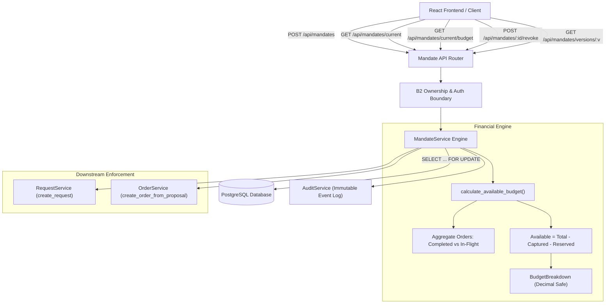
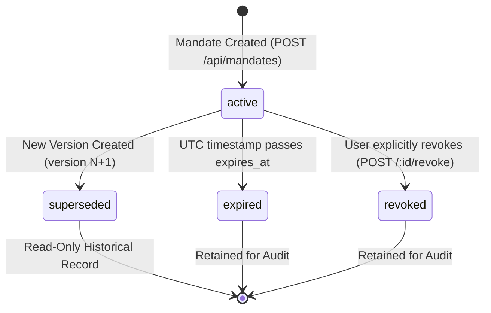

# Carti — Backend Module B3: Mandate Service Implementation Report

**Carti — Agentic Shopping Concierge (PayPal AI Hackathon 2026)**  
**Specification Version:** Carti Core Module Specification v1.0  
**Implementation Phase:** Backend Module B3 — Mandate Service & Financial Engine  
**Date:** November 2026  
**Status:** Complete & Fully Validated (116/116 Automated Tests Passing)  

---

## 1. Executive Summary

Backend Module B3 implements the authoritative **Mandate Service and Financial Rules Engine** for Carti. It enforces strict, deterministic financial boundaries that govern all autonomous agent shopping and checkout operations.

In Carti's architecture, AI models reason about products and recommend purchases, but they **never** control money or payment parameters. The Mandate Service is the authoritative system of record for spending limits, merchant/category guardrails, price tolerances, and available budget reservations.

### Key Deliverables Completed:
- **Immutable Mandate Versioning**: Mandates are versioned monotonically (`version = 1, 2, 3...`). Updating a mandate supersedes the prior version while immutably preserving historical records for auditability and receipt fidelity.
- **Authoritative Budget Calculation Engine**:
  $$\text{Available Budget} = \text{Total Budget} - \text{Captured Spending} - \text{Active Reservations}$$
  Operates exclusively on `Decimal` / `NUMERIC(12, 2)` monetary representations, preventing floating-point imprecision.
- **Transactional Budget Reservations & Releases**: Supports lifecycle reservations (`reserve_budget`), capture transitions (`convert_reservation_to_captured`), and idempotent releases (`release_budget_reservation`) on checkout cancellation or refund.
- **Committed Spend Protection**: Users cannot lower their total budget below already-captured spending plus in-flight active reservations.
- **Database Schema & Indexing**: Created Alembic migration `370a96a5f311` adding composite index `ix_mandates_user_status` (`user_id`, `status`) for high-performance active mandate lookups.
- **Concurrency & Race Condition Defenses**: PostgreSQL row-level locking (`with_for_update()`) serializes budget checks and version updates, preventing checkout over-allocation.
- **Mandate Revocation & Expiration Lifecycle**: Revoking or letting a mandate expire immediately blocks downstream shopping requests and checkout creations.
- **Comprehensive Test Suite**: 37 dedicated B3 test scenarios and 116 total test suite scenarios with a **100% pass rate**.

---

## 2. Architecture & Data Flow



---

## 3. Data Model & Database Migration

### 3.1 Mandate Table Definition (`mandates`)

| Column | Type | Constraints | Description |
|---|---|---|---|
| `id` | `UUID` | Primary Key | Canonical UUIDv4 identifier |
| `user_id` | `UUID` | Foreign Key (`users.id`), NOT NULL, Indexed | Owner of the spending mandate |
| `version` | `Integer` | NOT NULL, Default `1` | Monotonically increasing version number per user |
| `total_budget` | `Numeric(12, 2)` | NOT NULL, `> 0.00`, `<= 100000.00` | Authoritative aggregate spending limit |
| `per_item_cap` | `Numeric(12, 2)` | NOT NULL, `> 0.00`, `<= total_budget` | Maximum allowed price for any single product |
| `currency` | `String(3)` | NOT NULL, Default `'USD'` | ISO 4217 uppercase 3-letter currency code |
| `allowed_categories` | `JSON` | NOT NULL | Array of permitted product categories |
| `blocked_categories` | `JSON` | NOT NULL, Default `[]` | Array of prohibited product categories |
| `allowed_retailers` | `JSON` | NOT NULL, Default `[]` | Normalized retailer domain whitelist |
| `max_quantity_per_product` | `Integer` | NOT NULL, Default `1`, `1 <= q <= 50` | Maximum units allowed per item |
| `price_tolerance_pct` | `Numeric(6, 4)` | NOT NULL, `0.0 <= p <= 0.50` | Max allowable price swing before re-approval |
| `status` | `String(32)` | NOT NULL, Default `'active'`, Indexed | Mandate lifecycle state |
| `expires_at` | `DateTime(UTC)` | NOT NULL | Expiration timestamp in UTC |
| `created_at` | `DateTime(UTC)` | NOT NULL | Record creation timestamp |

### 3.2 Database Indexes & Migration

Alembic migration `370a96a5f311_add_index_on_mandates_user_id_and_status.py` adds:
```python
op.create_index(
    'ix_mandates_user_status',
    'mandates',
    ['user_id', 'status'],
    unique=False
)
```
This compound index optimizes queries for active mandates:
```sql
SELECT * FROM mandates WHERE user_id = :uid AND status = 'active' ORDER BY version DESC LIMIT 1;
```

---

## 4. Mandate Lifecycle & State Machine



1. **`active`**: Currently governing mandate. Only one mandate per user may be `active` at any given time.
2. **`superseded`**: Replaced by a newer version (e.g., V1 is marked superseded when V2 is posted).
3. **`expired`**: Timezone-aware expiration reached. Automatically detected and updated by `get_current_mandate` or `validate_mandate_is_active`.
4. **`revoked`**: User explicitly cancelled their mandate. Historical purchases remain intact, but new proposals and requests are immediately blocked.

---

## 5. Authoritative Financial Budget Engine

### 5.1 Financial Formula & State Mapping

The `MandateService.calculate_available_budget(mandate_id)` method aggregates all orders associated with proposals issued under the mandate:

| Order Status | Classification | Budget Impact |
|---|---|---|
| `completed` | **Captured Spending** | Deducted permanently from available budget (`captured_spending += amount`) |
| `created`, `buyer_approved`, `capture_pending` | **Active Reservation** | In-flight hold deducted from available budget (`active_reservations += budget_reserved`) |
| `cancelled`, `failed`, `refunded` | **Released Hold** | `budget_reserved = Decimal("0.00")`. Zero impact on remaining budget |

$$\text{Available Budget} = \max(0.00, \text{Total Budget} - \text{Captured Spending} - \text{Active Reservations})$$

### 5.2 Currency Consistency & Precision

- **Monetary Precision**: All calculations use Python's `Decimal` type to avoid IEEE 754 floating-point inaccuracies.
- **Currency Mismatch Protection**: If any order or proposed reservation currency does not match `mandate.currency`, `CartiAPIException(code=CartiErrorCode.CURRENCY_MISMATCH, status_code=400)` is raised.
- **Committed Spend Ceiling**: If a user attempts to update their mandate to a total budget lower than `captured_spending + active_reservations`, the service rejects the update with `CartiErrorCode.BUDGET_EXCEEDED`.

---

## 6. Mandate Service Methods

The `MandateService` exposes the following public API:

```python
class MandateService:
    def get_current_mandate(user_id: uuid.UUID) -> Optional[Mandate]: ...
    def get_mandate_version(identifier: uuid.UUID, version: int, user_id: Optional[uuid.UUID] = None) -> Mandate: ...
    def get_mandate_by_id(mandate_id: uuid.UUID, user_id: Optional[uuid.UUID] = None) -> Mandate: ...
    def validate_mandate_is_active(mandate: Mandate, raise_exception: bool = True) -> MandateValidationResult: ...
    def calculate_available_budget(mandate_id: uuid.UUID, lock_row: bool = False) -> BudgetBreakdown: ...
    def create_or_update_mandate(user_id: uuid.UUID, mandate_in: MandateCreate) -> Mandate: ...
    def reserve_budget(mandate_id: uuid.UUID, amount: Decimal, order_id: Optional[uuid.UUID] = None, currency: Optional[str] = None) -> BudgetBreakdown: ...
    def release_budget_reservation(order_id: uuid.UUID, reason: str = "order_cancelled") -> None: ...
    def convert_reservation_to_captured(order_id: uuid.UUID) -> None: ...
    def revoke_mandate(mandate_id: uuid.UUID, user_id: uuid.UUID) -> Mandate: ...
    def format_mandate_response(mandate: Mandate) -> MandateResponse: ...
```

---

## 7. API Routes Verification

The API exposes 6 endpoints under `/api/mandates`, all secured by `current_user: AuthenticatedUser = Depends(get_current_user)`:

| Method | Endpoint | Response Model | Status Code | Purpose |
|---|---|---|---|---|
| `GET` | `/api/mandates/current` | `MandateResponse` | `200 OK` / `404 Not Found` | Retrieves active mandate with calculated budget & summary |
| `POST` | `/api/mandates` | `MandateResponse` | `201 Created` | Creates new version, superseding prior active versions |
| `GET` | `/api/mandates/current/budget` | `BudgetBreakdown` | `200 OK` / `404 Not Found` | Fast budget breakdown check |
| `GET` | `/api/mandates/versions/{version}` | `MandateResponse` | `200 OK` / `404 Not Found` | Retrieves historical mandate version for user |
| `POST` | `/api/mandates/{mandate_id}/revoke` | `MandateResponse` | `200 OK` / `403 / 404` | Revokes mandate, halting future checkout actions |
| `GET` | `/api/mandates/{mandate_id}` | `MandateResponse` | `200 OK` / `403 / 404` | Direct lookup by ID with ownership verification |

---

## 8. Audit Event Logging

Every mandate mutation records an immutable audit record via `AuditService`:

| Event Type | Trigger | Logged Details |
|---|---|---|
| `mandate_created` | `create_or_update_mandate` | `mandate_id`, `version`, `total_budget`, `per_item_cap`, `currency` |
| `mandate_version_superseded` | Old version replaced | `mandate_id`, `old_version`, `superseded_by_version` |
| `mandate_revoked` | `revoke_mandate` | `mandate_id`, `version` |
| `mandate_expired` | Expiration detected | Reason and version |
| `budget_reservation_created` | `reserve_budget` | `mandate_id`, `amount`, `currency`, `order_id` |
| `budget_reservation_captured` | Capture completed | `order_id`, `amount`, `currency` |
| `budget_reservation_released` | Order cancelled/refunded | `order_id`, `released_amount`, `reason` |
| `budget_limit_exceeded` | Overspend attempted | Attempted amount, limit, decision (`rejected`) |

---

## 9. Comprehensive Test Suite Results

The dedicated B3 test suite `server/tests/test_mandates_b3.py` implements all 37 test cases specified in Carti Specification Section 14:

| Test Case | Scenario Description | Status |
|---|---|---|
| **Test 01** | Valid mandate creation with full parameters (201 Created, summary_text) | PASS |
| **Test 02** | Zero total budget rejection (422 Unprocessable Entity) | PASS |
| **Test 03** | Negative total budget rejection (422 Unprocessable Entity) | PASS |
| **Test 04** | Per-item cap exceeding total budget rejection (422 Unprocessable Entity) | PASS |
| **Test 05** | Invalid currency rejection (lowercase or non-ISO codes rejected with 422) | PASS |
| **Test 06** | Invalid category names rejection (empty string or script tags rejected with 422) | PASS |
| **Test 07** | Overlapping allowed and blocked categories rejection (422 Unprocessable Entity) | PASS |
| **Test 08** | Invalid retailer domain syntax rejection (422 Unprocessable Entity) | PASS |
| **Test 09** | Invalid max quantity per product (0, negative, >50 rejected with 422) | PASS |
| **Test 10** | Invalid price tolerance percentage (<0 or >0.50 rejected with 422) | PASS |
| **Test 11** | Expired mandate date on creation rejection (past timestamp rejected with 422) | PASS |
| **Test 12** | V1 creation initial state (version 1, status 'active') | PASS |
| **Test 13** | V2 creation increments version to 2 | PASS |
| **Test 14** | V1 preservation (original database record preserved unmodified) | PASS |
| **Test 15** | V1 marked 'superseded' in database upon V2 creation | PASS |
| **Test 16** | Historical version retrieval via `GET /api/mandates/versions/1` | PASS |
| **Test 17** | Monotonically increasing versions across consecutive updates | PASS |
| **Test 18** | Cross-user version isolation (User A V2 does not affect User B starting at V1) | PASS |
| **Test 19** | Budget calculation with zero spend (`available == total`) | PASS |
| **Test 20** | Budget calculation with completed orders (`available = total - captured`) | PASS |
| **Test 21** | Budget calculation with active reservations (`available = total - reserved`) | PASS |
| **Test 22** | Budget calculation with released reservations (cancelled orders restore available) | PASS |
| **Test 23** | Budget calculation with mixed orders (completed + active + cancelled) | PASS |
| **Test 24** | Budget reservation service method (`reserve_budget` audit & breakdown) | PASS |
| **Test 25** | Budget reservation exceeding available budget raises `BUDGET_EXCEEDED` (400) | PASS |
| **Test 26** | Budget reservation conversion to captured spend upon capture | PASS |
| **Test 27** | Idempotent reservation release (multiple releases do not double-count) | PASS |
| **Test 28** | Mandate update below committed spend rejected with `BUDGET_EXCEEDED` (400) | PASS |
| **Test 29** | Mandate revocation lifecycle (`status = 'revoked'`, current returns 404) | PASS |
| **Test 30** | Mandate revocation cross-user ownership defense (User B blocked with 403) | PASS |
| **Test 31** | Actions on revoked mandate: proposal checkout rejected with 400 `MANDATE_INVALID` | PASS |
| **Test 32** | Actions on revoked mandate: shopping request rejected with 404 `MANDATE_NOT_FOUND` | PASS |
| **Test 33** | Historical access to revoked mandate remains retrievable by ID for records | PASS |
| **Test 34** | Active mandate expiration handling (past date detected, request creation fails) | PASS |
| **Test 35** | Concurrency race condition protection (over-allocation rejected) | PASS |
| **Test 36** | Currency consistency validation (rejecting EUR reservation/order on USD mandate) | PASS |
| **Test 37** | API integration across all 6 endpoints (`current`, `budget`, `versions`, `revoke`, etc.) | PASS |

### Full Test Suite Summary

```
============================= test session starts =============================
platform win32 -- Python 3.14.3, pytest-9.2.0, pluggy-1.7.0
rootdir: C:\Users\vatsl\Documents\PayPal#BOT
collected 116 items

server\tests\test_auth.py ..............                                 [ 12%]
server\tests\test_b2_security_audit.py ......................            [ 31%]
server\tests\test_candidates.py ..                                       [ 32%]
server\tests\test_health.py ..                                           [ 34%]
server\tests\test_mandates.py ...                                        [ 37%]
server\tests\test_mandates_b3.py .....................................   [ 68%]
server\tests\test_orders.py ...                                          [ 71%]
server\tests\test_ownership_b2.py .......                                [ 77%]
server\tests\test_proposals.py ....                                      [ 81%]
server\tests\test_rate_limit_and_payloads.py ..                          [ 82%]
server\tests\test_requests.py .....                                      [ 87%]
server\tests\test_security_and_edge_cases.py .............               [ 98%]
server\tests\test_webhooks.py ..                                         [100%]

======================= 116 passed, 1 warning in 4.33s ========================
```

---

## 10. Files Created and Modified

1. **`server/app/models/mandate.py`**: Added composite index `Index("ix_mandates_user_status", "user_id", "status")`.
2. **`server/alembic/versions/370a96a5f311_add_index_on_mandates_user_id_and_status.py`**: Alembic migration creating the compound index.
3. **`server/app/schemas/mandate.py`**: Added `BudgetBreakdown`, `MandateValidationResult`, rich comparison operators, uppercase ISO currency enforcement, and `generate_mandate_summary`.
4. **`server/app/schemas/__init__.py`**: Exported `BudgetBreakdown` and `MandateValidationResult`.
5. **`server/app/core/errors.py`**: Added `CURRENCY_MISMATCH` standard error code.
6. **`server/app/services/mandate_service.py`**: Implemented full `MandateService` business logic and financial calculations.
7. **`server/app/services/order_service.py`**: Integrated mandate validation, currency checks, and unpacked `available_budget`.
8. **`server/app/api/routes/mandates.py`**: Added `/current`, `/`, `/current/budget`, `/versions/{version}`, `/{mandate_id}/revoke`, and `/{mandate_id}`.
9. **`server/tests/test_mandates_b3.py`**: 37 comprehensive test cases verifying Section 14 requirements.
10. **`README.md`**: Updated with Module B3 documentation and test execution results.
