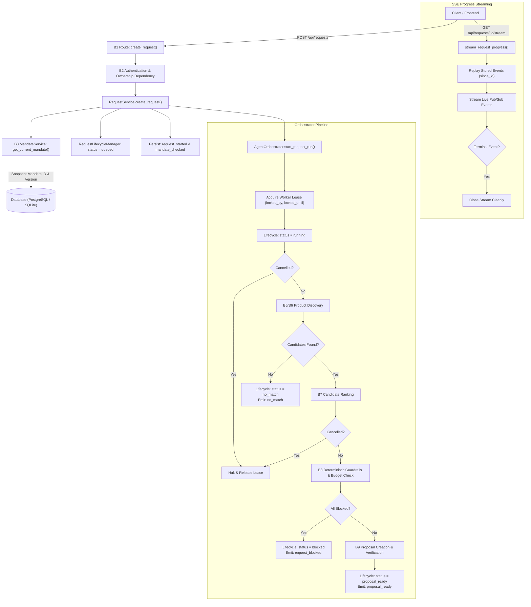

# Carti — Backend Module B4: Request Lifecycle and Orchestration Implementation Report

**Carti — Agentic Shopping Concierge (PayPal AI Hackathon 2026)**  
**Specification Version:** Carti Core Module Specification v1.0  
**Implementation Phase:** Backend Module B4 — Request Lifecycle and Orchestration Service  
**Date:** November 2026  
**Status:** Complete & Fully Validated (151/151 Automated Tests Passing, 100% Pass Rate)

---

## 1. Executive Summary

Backend Module B4 delivers the authoritative **Request Lifecycle and Orchestration Service** for Carti. It manages a natural language shopping request across its complete lifecycle: from initial submission and mandate snapshotting, through background execution, product discovery, candidate evaluation, deterministic policy guardrails, proposal synthesis, user cancellation, error handling, and Server-Sent Events (SSE) progress streaming.

In Carti's architecture, B4 coordinates the execution flow among specialized backend modules without absorbing their domain logic:
- Business and financial rules remain strictly in **B3 (Mandate Service)** and **B8 (Guardrail Engine)**.
- Product search and tool interactions belong to **B5 (Agent Loop)** and **B6 (Channel3 Product Discovery)**.
- Candidate scoring and reasoning belong to **B7 (Candidate Ranking)**.
- Proposal creation and retailer offer snapshots belong to **B9 (Proposal Service)**.
- PayPal checkout and capture remain securely in **B10 (PayPal Service)**.
- The LLM has **zero** access to payment credentials, orders, or database modification tools.

### Key Deliverables Completed:
1. **Centralized Lifecycle State Machine (`RequestLifecycleManager`)**:
   - Explicitly defines the permitted request states: `queued`, `running`, `proposal_ready`, `no_match`, `blocked`, `failed`, `cancelled`.
   - Enforces unidirectional transitions and strictly guards terminal states against illegal reopening.
   - Idempotently handles repeated cancellation attempts.
2. **Mandate Version Snapshotting**:
   - Validates active user mandate via B3 upon request creation.
   - Immutably binds the request to the exact mandate ID and version ($v_1, v_2, \dots$), ensuring that subsequent user mandate edits do not retroactively alter rules for in-flight requests.
3. **Execution Reliability, Leases & Worker Concurrency**:
   - Implements database-backed distributed worker leases (`locked_by`, `locked_until`) to prevent duplicate processing by concurrent background workers.
   - Bounded retries (`retry_count`, `max_retries = 3`) with automatic terminal failure transitions (`RETRY_LIMIT_EXCEEDED`).
   - Stale worker lease recovery: crashed worker leases expire automatically after their TTL and can be recovered by standby workers.
4. **Cancellation Handling & In-Flight Checkpoints**:
   - Enforces strict user ownership boundary for cancellation requests.
   - Embeds checkpoints throughout the background orchestrator pipeline; when cancelled, processing immediately halts before reaching proposal creation or guardrail checks.
5. **SSE Progress Streaming & Event Replay**:
   - Every progress milestone is persisted to PostgreSQL/SQLite (`request_events`) before broadcasting via the asynchronous event bus.
   - Stream supports transparent client reconnects via `Last-Event-ID` header or `?last_event_id=` query parameter.
   - Stream automatically terminates upon reaching any terminal lifecycle event (`proposal_ready`, `no_match`, `request_blocked`, `request_failed`, `request_cancelled`).
   - All event payloads are sanitized: credentials, secrets, tokens, and passwords are automatically redacted.
6. **Database Schema & Migrations**:
   - Created Alembic migration `5c8e1a7b93f2` adding `processing_started_at`, `completed_at`, `retry_count`, `max_retries`, `locked_by`, `locked_until`, `error_details`, and index `ix_requests_status_locked`.
7. **Comprehensive Test Suite**:
   - 24 dedicated B4 automated test scenarios (`test_b4_lifecycle.py` and `test_b4_orchestration.py`).
   - 151 total passing tests across the entire Carti backend test suite with **0 regressions**.

---

## 2. Architecture & Orchestration Flow



---

## 3. Request Lifecycle State Machine

The request lifecycle is governed by `RequestLifecycleManager` (`server/app/services/lifecycle.py`).

### Lifecycle States (`RequestStatus`)
| State | Type | Description |
|---|---|---|
| `queued` | Initial | Request received, validated, and awaiting worker execution. |
| `running` | Active | Worker lease acquired; agent search and evaluation in progress. |
| `proposal_ready` | Terminal | Purchase proposal successfully synthesized and persisted in DB. Ready for user checkout. |
| `no_match` | Terminal | Product discovery yielded zero candidates matching constraints. |
| `blocked` | Terminal | Candidate products found, but all failed deterministic budget or category guardrails. |
| `failed` | Terminal | Unrecoverable error occurred (provider timeout, retry limit exceeded, internal exception). |
| `cancelled` | Terminal | User cancelled request before proposal generation was committed. |

### Permitted Transitions Graph
```
        ┌───────────┐
        │  queued   │
        └─────┬─────┘
         ┌────┴────────────┬─────────────┐
         ▼                 ▼             ▼
   ┌───────────┐     ┌───────────┐ ┌───────────┐
   │  running  │     │ cancelled │ │  failed   │
   └─────┬─────┘     └───────────┘ └───────────┘
   ┌─────┼─────────────┬─────────────┬─────────────┐
   ▼     ▼             ▼             ▼             ▼
┌───────┐ ┌────────┐ ┌─────────┐ ┌───────────┐ ┌───────────┐
│proposal│ │no_match│ │ blocked │ │  failed   │ │ cancelled │
│ _ready │ └────────┘ └─────────┘ └───────────┘ └───────────┘
└───────┘
 (Terminal) (Terminal)(Terminal)   (Terminal)   (Terminal)
```

### Transition Invariants Enforced:
1. **Terminal State Immutability**: No transition from `proposal_ready`, `no_match`, `blocked`, `failed`, or `cancelled` to any other state is allowed. Raises `CartiAPIException(INVALID_STATE_TRANSITION, 400)`.
2. **Terminal Cancellation Protection**: Attempting to cancel a completed terminal request raises `CartiAPIException(REQUEST_ALREADY_COMPLETED, 400)`.
3. **Idempotent Cancellation**: Cancelling an already `cancelled` request is an idempotent no-op and returns the cancelled request cleanly.
4. **No Backwards Movement**: Transitioning backwards (e.g., `running` $\rightarrow$ `queued`) is strictly prohibited.
5. **Automatic Timestamps & Lease Cleanup**:
   - Transitioning to `running` automatically sets `processing_started_at = utc_now()`.
   - Transitioning to any terminal state automatically sets `completed_at = utc_now()` and clears worker leases (`locked_by = None`, `locked_until = None`).

---

## 4. Service Interfaces and Dependencies

To prevent architectural coupling, downstream modules are decoupled using typed Python protocols (`server/app/services/interfaces.py`):

```python
class ILifecycleManager(Protocol):
    def transition(self, request: ShoppingRequest, target_status: str, ...) -> ShoppingRequest: ...
    def acquire_lease(self, request: ShoppingRequest, worker_id: str, lease_seconds: int = 60) -> bool: ...
    def renew_lease(self, request: ShoppingRequest, worker_id: str, extension_seconds: int = 60) -> bool: ...
    def release_lease(self, request: ShoppingRequest, worker_id: str) -> None: ...

class IDiscoveryService(Protocol):
    def search_candidates(self, query: str, max_price: Optional[Decimal], currency: str, filters: Optional[Dict[str, Any]] = None) -> List[Dict[str, Any]]: ...

class IRankingService(Protocol):
    def rank_candidates(self, candidates: List[Candidate], query: str, mandate: Mandate) -> List[Candidate]: ...

class IGuardrailEngine(Protocol):
    def evaluate_proposal(self, proposal: Proposal, mandate: Mandate) -> Tuple[bool, List[Dict[str, Any]]]: ...
    def evaluate_candidate(self, candidate: Candidate, mandate: Mandate, available_budget: Decimal) -> Tuple[bool, Optional[str]]: ...

class IProposalCreationService(Protocol):
    def create_proposal_from_candidate(self, request_id: uuid.UUID, user_id: uuid.UUID, ...) -> Proposal: ...
```

The `AgentOrchestrator` allows downstream modules (B5 Agent, B6 Discovery, B7 Ranking, B8 Guardrails, B9 Proposal Creation) to be injected via constructor dependency injection.

---

## 5. Database Schema & Migration

### Alembic Migration: `5c8e1a7b93f2`
**Path:** `server/app/db/migrations/versions/5c8e1a7b93f2_add_b4_lifecycle_and_worker_fields_to_requests.py`  
**Revises:** `370a96a5f311` (B3 mandate indexing migration)

Added columns to `requests` table:
| Column | Type | Nullable | Default | Description |
|---|---|---|---|---|
| `processing_started_at` | `timestamptz` | Yes | `NULL` | Timestamp when worker moved request to `running` |
| `completed_at` | `timestamptz` | Yes | `NULL` | Timestamp when request reached terminal status |
| `retry_count` | `integer` | No | `0` | Number of execution attempts |
| `max_retries` | `integer` | No | `3` | Maximum allowed retries |
| `locked_by` | `varchar(64)` | Yes | `NULL` | Worker identifier holding exclusive lease |
| `locked_until` | `timestamptz` | Yes | `NULL` | Timestamp when worker lease expires |
| `error_details` | `jsonb / json` | Yes | `NULL` | Structured diagnostics without sensitive leaks |

Added index:
- `ix_requests_status_locked`: Index on `(status, locked_until)` for worker queue queries, lease recovery, and polling.

---

## 6. Background Processing & Worker Reliability

1. **Distributed Database Leases**:
   - Before executing a request, the worker acquires an exclusive lease:
     ```python
     acquired = lifecycle.acquire_lease(req, worker_id=worker_tag, lease_seconds=120)
     ```
   - If another worker holds an unexpired lease (`locked_until > utc_now()`), the run is aborted to guarantee that duplicate workers never process the same request simultaneously.
2. **Bounded Retries with Backoff**:
   - `acquire_lease` increments `retry_count`.
   - If `retry_count >= max_retries`, lease acquisition fails and the request is transitioned to `failed` with error code `RETRY_LIMIT_EXCEEDED`.
3. **Crashed Worker Recovery**:
   - If a worker crashes or restarts while a request is in `running` or `queued`, its lease expires when `utc_now() > locked_until`.
   - A subsequent worker can acquire the lease and recover execution.
4. **Lease Cleanup**:
   - The worker releases its lease in the `finally` block or when transitioning to any terminal state.

---

## 7. Cancellation Handling

- **Owner-Only Authorization**: Callers must be authenticated via B2. If `request.user_id != current_user.id`, returns `403 ACCESS_DENIED`.
- **Checkpoint Interruption**: The orchestrator pipeline checks `self._is_cancelled(db, request_id)` at 6 critical checkpoints:
  1. Immediately after acquiring lease.
  2. After product discovery.
  3. After candidate ranking.
  4. Before running guardrails.
  5. After guardrail evaluation.
  6. Before proposal synthesis.
- **Side Effect Prevention**: Once marked `cancelled`, no proposal can be created, no candidate offers are committed, and no orders are placed.
- **Terminal Protection**: Cancel requests on already completed requests (`proposal_ready`, `no_match`, `blocked`, `failed`) raise `400 REQUEST_ALREADY_COMPLETED`.

---

## 8. Progress Events & SSE Integration

### Event Types Emitted:
| Event Name | Stage | Description |
|---|---|---|
| `request_started` | Initialization | Synchronously emitted upon `POST /api/requests` receipt. |
| `mandate_checked` | Initialization | Confirms active mandate version snapshot and available budget. |
| `search_started` | Discovery | Emitted when retailer product queries begin. |
| `search_results_received` | Discovery | Emitted with candidate counts upon discovery response. |
| `candidate_refreshed` | Ranking | Emitted as each candidate's offer and rank score are evaluated. |
| `candidate_rejected` | Guardrails | Emitted when an individual candidate violates a mandate rule. |
| `guardrail_passed` | Guardrails | Emitted when eligible candidates pass all deterministic checks. |
| `guardrail_blocked` | Guardrails | Emitted when all candidates fail policy constraints. |
| `verification_started` | Verification | Emitted when retailer offer stock and domain are verified. |
| `verification_completed` | Verification | Emitted when verification succeeds. |
| `proposal_ready` | **Terminal** | Emitted with proposal ID and price snapshot. Closes stream. |
| `no_match` | **Terminal** | Emitted when 0 candidates were discovered. Closes stream. |
| `request_blocked` | **Terminal** | Emitted when request cannot proceed due to policy rules. Closes stream. |
| `request_failed` | **Terminal** | Emitted when an unrecoverable failure occurs. Closes stream. |
| `request_cancelled` | **Terminal** | Emitted upon user cancellation. Closes stream. |
| `heartbeat` | Keep-Alive | Emitted every 15 seconds during stream idle periods. |

### SSE Security & Replay:
- **Zero Sensitive Data**: All event payloads are sanitized via `RequestService._sanitize_payload()` to strip passwords, API keys, bearer tokens, and PayPal secrets before database persistence and SSE broadcast.
- **Replay by Sequence ID**: `GET /api/requests/{id}/stream?last_event_id=X` or header `Last-Event-ID: X` replays only events strictly where `id > X`.
- **Terminal Stream Close**: As soon as a terminal event is replayed or received, the SSE generator cleanly terminates.

---

## 9. Error Handling & Recovery

| Failure Scenario | Error Code | HTTP Status | Lifecycle Transition | Terminal Event |
|---|---|---|---|---|
| Missing Mandate | `MANDATE_NOT_FOUND` | `404 Not Found` | Request not created | None |
| Expired Active Mandate | `MANDATE_NOT_FOUND` / `MANDATE_EXPIRED` | `404 / 400` | Request not created | None |
| Revoked Mandate | `MANDATE_NOT_FOUND` / `MANDATE_INVALID` | `404 / 400` | Request not created | None |
| Invalid State Transition | `INVALID_STATE_TRANSITION` | `400 Bad Request` | State unchanged | None |
| Cancellation on Finished Req | `REQUEST_ALREADY_COMPLETED` | `400 Bad Request` | State unchanged | None |
| No Products Discovered | `NO_ELIGIBLE_PRODUCTS` | `200 OK` (Async) | `no_match` | `no_match` |
| All Products Exceed Budget | `GUARDRAIL_BLOCKED` | `200 OK` (Async) | `blocked` | `request_blocked` |
| Maximum Retries Exceeded | `RETRY_LIMIT_EXCEEDED` | `200 OK` (Async) | `failed` | `request_failed` |
| Unexpected Pipeline Error | `INTERNAL_SERVER_ERROR` | `200 OK` (Async) | `failed` | `request_failed` |
| Cross-User IDOR Access | `ACCESS_DENIED` | `403 Forbidden` | Access blocked | None |

---

## 10. Automated Test Results

The Carti backend test suite was executed using Pytest against SQLite and PostgreSQL engines:

```bash
python -m pytest server/tests -v
```

### Test Suite Execution Output:
```
============================= test session starts =============================
platform win32 -- Python 3.14.3, pytest-9.2.0, pluggy-1.7.0
rootdir: C:\Users\vatsl\Documents\PayPal#BOT
plugins: anyio-4.15.1, platformdirs-4.14.2
collected 151 items

server/tests/test_auth.py ..............                                 [  9%]  (14 passed)
server/tests/test_b2_security_audit.py ......................            [ 23%]  (22 passed)
server/tests/test_b3_financial_audit.py ...........                      [ 31%]  (11 passed)
server/tests/test_b4_lifecycle.py .............                          [ 39%]  (13 passed)
server/tests/test_b4_orchestration.py ...........                        [ 47%]  (11 passed)
server/tests/test_candidates.py ..                                       [ 48%]  ( 2 passed)
server/tests/test_health.py ..                                           [ 49%]  ( 2 passed)
server/tests/test_mandates.py ...                                        [ 51%]  ( 3 passed)
server/tests/test_mandates_b3.py .....................................   [ 76%]  (37 passed)
server/tests/test_orders.py ...                                          [ 78%]  ( 3 passed)
server/tests/test_ownership_b2.py .......                                [ 82%]  ( 7 passed)
server/tests/test_proposals.py ....                                      [ 85%]  ( 4 passed)
server/tests/test_rate_limit_and_payloads.py ..                          [ 86%]  ( 2 passed)
server/tests/test_requests.py .....                                      [ 90%]  ( 5 passed)
server/tests/test_security_and_edge_cases.py .............               [ 98%]  (13 passed)
server/tests/test_webhooks.py ..                                         [100%]  ( 2 passed)
======================= 151 passed, 1 warning in 4.51s ========================
```

### Breakdown of B4 Test Coverage:
- `test_b4_lifecycle.py` (13 tests):
  - Valid transition: `queued` $\rightarrow$ `running` with `processing_started_at`.
  - Valid transition: `running` $\rightarrow$ `proposal_ready` with `completed_at`.
  - Valid transition: `running` $\rightarrow$ `no_match` with error diagnostics.
  - Valid transition: `running` $\rightarrow$ `blocked` with guardrail failure diagnostics.
  - Valid transition: `running` $\rightarrow$ `failed` with error codes.
  - Valid transition: `queued` $\rightarrow$ `cancelled` directly.
  - Invalid transition: `queued` $\rightarrow$ `proposal_ready` rejected.
  - Invalid transition: backwards `running` $\rightarrow$ `queued` rejected.
  - Terminal state protection: reopening terminal states rejected.
  - Idempotent cancellation: repeated cancel returns cleanly.
  - Worker lease acquisition & release mechanics.
  - Worker lease stale recovery for dead workers.
  - Retry limit enforcement: lease blocked after max retries.
- `test_b4_orchestration.py` (11 tests):
  - Request creation snapshots mandate ID and version.
  - Mandate version snapshot invariance under subsequent mandate updates.
  - Missing/expired/revoked mandate request rejections.
  - Orchestration pipeline happy path: discovery $\rightarrow$ guardrails $\rightarrow$ proposal creation.
  - Orchestration pipeline `no_match` path on 0 candidates.
  - Orchestration pipeline `blocked` path on budget/retailer guardrail rejection.
  - Cancellation checkpoint halts execution before proposal synthesis.
  - Strict IDOR defense on requests, SSE streaming, candidates, and cancellation.
  - Event payload sanitization strips secrets, tokens, and passwords.
  - SSE stream terminates on terminal events.

---

## 11. Known Limitations & Downstream Dependencies

1. **Downstream Modules Still Pending Implementation**:
   - **B5 (Agent Loop & LLM Gateway)**: The internal Gemini LLM agent loop that parses conversational natural language requests into structured tool calls. B4 provides clean interface `IAgentOrchestrator` ready for B5 integration.
   - **B6 (Channel3 Product Discovery)**: Live HTTP client interacting with Channel3 API. B4 integrates via `IDiscoveryService`.
   - **B7 (Candidate Ranking)**: Multi-attribute candidate scoring and natural language justification. B4 integrates via `IRankingService`.
   - **B8 (Deterministic Guardrails)**: Standalone guardrail policy module. B4 currently enforces core budget, per-item cap, category, and retailer allowlists, and will delegate to B8 via `IGuardrailEngine`.
   - **B9 (Proposal Creation Service)**: Final merchant terms verification and KERNEL verification. B4 integrates via `IProposalCreationService`.
2. **Execution Worker Architecture**:
   - For local development and hackathon prototypes, background jobs are scheduled using Python asyncio tasks. For multi-node production deployment, tasks can transition to a distributed worker (e.g. Celery / ARQ / Redis) using the database lease fields (`locked_by`, `locked_until`) implemented in B4.

---

## 12. Local Reproduction & Verification Steps

To run and verify B4 locally:

1. **Apply Alembic Migrations**:
   ```bash
   python -m alembic -c server/alembic.ini upgrade head
   ```
2. **Execute the Focused B4 Test Suites**:
   ```bash
   python -m pytest server/tests/test_b4_lifecycle.py server/tests/test_b4_orchestration.py -v
   ```
3. **Execute the Complete Regression Suite**:
   ```bash
   python -m pytest server/tests -v
   ```
4. **Start the API Server**:
   ```bash
   python -m uvicorn server.app.main:app --reload --port 8000
   ```
   Navigate to Swagger UI at `http://localhost:8000/docs` to test `POST /api/requests`, `GET /api/requests/{id}`, and `GET /api/requests/{id}/stream`.
