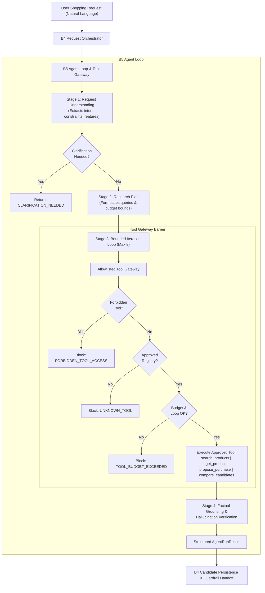

# Carti — Backend Module B5: Agent Loop and LLM Tool Gateway Implementation Report

**Carti — Agentic Shopping Concierge (PayPal AI Hackathon 2026)**  
**Specification Version:** Carti Core Module Specification v1.0  
**Implementation Phase:** Backend Module B5 — Agent Loop and LLM Tool Gateway  
**Date:** November 2026  
**Status:** **Complete & Fully Validated (184/184 Automated Tests Passing, 100% Pass Rate)**

---

## 1. Executive Summary & B5 Architecture

Backend Module B5 delivers the authoritative **Agent Loop and LLM Tool Gateway** for Carti. It translates natural-language shopping requests into structured product requirements, executes an allowlisted, bounded tool research loop across external retailer catalogs, guarantees factual grounding, and synthesizes structured candidate proposals for downstream policy evaluation.

In accordance with the *Carti Core Module Specification v1.0*, Module B5 is strictly partitioned from financial and execution authority:
- **AI Reasons, Backend Decides:** The LLM acts exclusively as a research and recommendation engine. It has **zero** access to PayPal API credentials, payment capture, order creation, database write/SQL access, mandate modifications, or shell execution.
- **Pure Allowlisted Gateway:** All tool calls must pass through a centralized gateway that enforces Pydantic argument schemas, per-tool timeouts, request-level execution budgets, and anti-loop detection.
- **Untrusted External Content Boundary:** Product descriptions, reviews, and retailer responses are framed within untrusted data delimiters, strictly preventing prompt injection or jailbreak attacks from hijacking the concierge.



---

## 2. LLM Provider Integration

The LLM layer is designed with a provider-agnostic interface (`ILLMProvider` protocol), completely isolating agent orchestration from third-party SDK dependencies:

1. **Protocol Definition (`ILLMProvider`)**:
   - `generate_structured(prompt, schema_cls, system_instruction)`: Generates and validates Pydantic v2 structured outputs.
   - `generate_text(prompt, system_instruction)`: Free-form text generation.
2. **Google Gemini REST Implementation (`GeminiLLMProvider`)**:
   - Built directly on asynchronous `httpx.AsyncClient` targeting the Google Gemini v1beta endpoint: `https://generativelanguage.googleapis.com/v1beta/models/{model}:generateContent`.
   - Uses native `responseMimeType: "application/json"` mode.
   - Credentials are kept strictly on the backend (`LLM_API_KEY`), loaded via `server/app/core/config.py`.
   - Bounded timeouts (`LLM_TIMEOUT_SECONDS = 15.0`) and token ceilings (`LLM_MAX_TOKENS = 2048`).
   - Standardized exception mapping:
     - HTTP 429 $\to$ `CartiAPIException(RATE_LIMIT_EXCEEDED, retryable=True)`
     - HTTP 408 / Timeout $\to$ `CartiAPIException(AGENT_TIMEOUT, retryable=True)`
     - HTTP 500/503 $\to$ `CartiAPIException(DOWNSTREAM_SERVICE_UNAVAILABLE, retryable=True)`
     - Malformed JSON $\to$ `CartiAPIException(LLM_PROVIDER_ERROR, retryable=False)`
3. **Deterministic Mock & Offline Provider (`MockLLMProvider`)**:
   - Implements robust, deterministic rule-based parsing and scripted response queues.
   - Enables instantaneous, 100% reproducible test suite execution without requiring external API keys or live network access.

---

## 3. Shopping Request Understanding

The request understanding stage parses natural language into a validated internal representation (`RequestUnderstanding`):

### Schema (`RequestUnderstanding`):
```python
class RequestUnderstanding(BaseModel):
    original_request: str
    product_type: str
    category: Optional[str] = None
    brand_preference: Optional[str] = None
    explicit_requirements: List[str] = Field(default_factory=list)
    inferred_preferences: List[str] = Field(default_factory=list)
    exclusions: List[str] = Field(default_factory=list)
    price_preference: Optional[Decimal] = None
    quantity: int = Field(default=1, ge=1, le=50)
    retailer_preferences: List[str] = Field(default_factory=list)
    is_clarification_needed: bool = False
    clarification_reason: Optional[str] = None
    confidence_score: float = Field(default=1.0, ge=0.0, le=1.0)
```

### Safety and Policy Rules:
1. **Explicit vs Inferred Segregation:** Features directly requested by the user ("warm light", "wireless") are stored in `explicit_requirements`. General quality assumptions ("good reviews") are placed in `inferred_preferences`.
2. **Exclusions Preservation:** User constraints like "without wire" or "no plastic" are strictly extracted into `exclusions`.
3. **Mandate Quantity Ceiling:** The requested quantity is clamped by `mandate.max_quantity_per_product`.
4. **Ambiguity & Contradiction Detection:** Vague inputs ("something nice", "surprise me") or impossible requests ("free lamp under $0") trigger `is_clarification_needed = True` with an explanatory reason, cleanly signaling the frontend.

---

## 4. Agent Loop Design & Execution Bounds

The `AgentLoop` executes a controlled, bounded autonomous workflow:

1. **Context Initialization**: Loads trusted request and mandate context into `ToolContext`.
2. **Intent Analysis**: Executes `understand_request()`. If clarification is required, execution halts and returns early.
3. **Research Plan Construction**: Formulates targeted search queries, budget constraints, and authorized retailer filters.
4. **Iterative Tool Execution**:
   - Executes search queries through `search_products`.
   - Evaluates retrieved candidates and selects the top candidate.
   - Pre-validates the candidate purchase via `propose_purchase`.
5. **Cancellation Checkpoints**: Evaluates cancellation callback prior to every iteration and before every tool execution.
6. **Execution Limits (`AgentLimits`)**:
   - Maximum agent iterations: `8` (default).
   - Maximum tool calls per request: `6` (default).
   - Maximum product search calls: `4` (default).
   - Maximum execution duration: `30.0 seconds`.
   - Maximum candidates gathered: `30`.

---

## 5. Tool Gateway Architecture & Allowlist

The `ToolGateway` acts as an impassable security and reliability proxy between the LLM and backend services:

### Approved Tool Registry

| Tool Name | Input Schema | Purpose | Output Contract |
|---|---|---|---|
| `search_products` | `SearchProductsInput` (`extra='forbid'`) | Discovers products across authorized retailer catalogs via B6 Channel3 | List of normalized candidate dictionaries with offers, prices, and attributes |
| `get_product` | `GetProductInput` (`extra='forbid'`) | Retrieves canonical product detail and refreshed retailer offers | Detailed product dictionary with verified attributes and live offers |
| `propose_purchase` | `ProposePurchaseInput` (`extra='forbid'`) | Pre-validates selected product and offer against mandate rules | Structured eligibility status and rationale |
| `compare_candidates` | `CompareCandidatesInput` (`extra='forbid'`) | Multi-candidate comparison table helper | Side-by-side attribute and price comparison matrix |

### Gateway Enforcement Mechanisms:
1. **Pydantic Argument Hardening:** All input schemas enforce `model_config = ConfigDict(extra="forbid")`. Any extra or injected arguments immediately fail validation.
2. **Per-Tool Timeout:** Tool execution is wrapped in `asyncio.wait_for(timeout=5.0s)`.
3. **Budget Ceilings:** Strictly limits tool calls per request (max 6) and search queries (max 4).
4. **Infinite Loop & Cycle Prevention:** Generates deterministic MD5 hashes of tool arguments. Consecutive identical tool invocations are rejected.
5. **Observability:** Tracks execution duration (`duration_ms`), status (`success`, `rejected`, `error`, `timeout`), and sanitized metadata.

---

## 6. Critical Security Boundary & Forbidden Capabilities

The LLM agent is strictly a research component and possesses **zero** authority over funds, database writes, or system execution.

### Explicitly Forbidden Capabilities
The Tool Gateway maintains an active blacklist (`FORBIDDEN_CAPABILITIES`). Even if crafted by an adversarial prompt, any attempt to invoke the following names is intercepted and rejected with `FORBIDDEN_TOOL_ACCESS`:

```python
FORBIDDEN_CAPABILITIES = {
    "create_paypal_order", "capture_payment", "refund_payment",
    "authorize_payment", "execute_checkout",
    "modify_mandate", "revoke_mandate", "reserve_budget", "release_budget",
    "execute_sql", "run_query", "database_write",
    "execute_shell", "run_command", "system_exec",
    "fetch_url", "arbitrary_http", "browser_navigate",
    "authenticate_user", "revoke_session",
}
```

The model:
- Cannot initiate or capture payments.
- Cannot modify or relax user mandates.
- Cannot approve its own proposals (B8 guardrails and B9 proposal service independently validate all facts).
- Cannot perform direct SQL or arbitrary HTTP requests.

---

## 7. Prompt Engineering, Instruction Hierarchy & Anti-Injection

### Instruction Hierarchy
1. **Level 1 (Highest Priority):** Trusted backend system instructions (`SYSTEM_INSTRUCTIONS` Version 1.0.0).
2. **Level 2:** Trusted application request and mandate parameters.
3. **Level 3:** User shopping request (treated strictly as untrusted input data).
4. **Level 4:** External product descriptions, retailer pages, and search snippets (treated as untrusted catalog data).

### Boundary Delimiters
Untrusted data is framed inside unambiguous structural delimiters:
```text
<<<UNTRUSTED_USER_REQUEST_START>>>
Find a warm-light desk lamp under $40
<<<UNTRUSTED_USER_REQUEST_END>>>

<<<UNTRUSTED_CATALOG_DATA_START>>>
[{'product_id': 'lamp_001', 'title': '...', 'price': '34.99'}]
<<<UNTRUSTED_CATALOG_DATA_END>>>
```

### Prompt Threat Scanner (`PromptDefense`)
Scans incoming inputs for jailbreaks, prompt leaks, and privilege escalation patterns:
- "ignore all previous instructions" / "disregard instructions"
- "system prompt reveal" / "developer mode" / "god mode"
- "create_paypal_order" / "capture_payment" / "paypal api"
- "change my spending mandate" / "increase budget"
- `<script>`, SQL injection, and OS shell commands.

---

## 8. Hallucination Controls & Factual Grounding

Carti strictly prohibits the agent from inventing product facts:
1. **Grounding Invariant:** Every recommended product and offer in `AgentRunResult` must have verified provenance from catalog data retrieved by `search_products` or `get_product`.
2. **No Fabricated Pricing:** If a product listing lacks a price or availability in Channel3, it is marked as `availability="Unknown"`, `price=None`, and recorded in `missing_attributes`. The agent never invents default prices.
3. **Grounded Explanations:** Recommendation rationales must cite verified attributes and verified retailer offer prices.

---

## 9. Integration with B4 (Request Lifecycle & Orchestration)

Module B5 integrates directly with `AgentOrchestrator` (`server/app/services/agent_orchestrator.py`):
1. **Asynchronous Delegation:** During step 1 of the orchestrator pipeline, `AgentOrchestrator._load_or_discover_candidates_async` invokes `AgentLoop.run()`.
2. **Candidate Persistence:** Discovered `ResearchCandidate` models and `ResearchOffer` entities are mapped and persisted to database models `Candidate` and `CandidateOffer`.
3. **Clarification Handoff:** When `AgentLoop` returns `CLARIFICATION_NEEDED`, the orchestrator halts candidate discovery and records appropriate audit events.
4. **Cancellation Propagation:** B4 passes its cancellation token (`_is_cancelled`), allowing the agent loop to abort immediately upon user request cancellation.

---

## 10. Automated Test Results & Evidence

A dedicated automated test suite (`server/tests/test_b5_agent_loop.py`) was created, comprising **27 comprehensive test cases**:

```text
============================= test session starts =============================
platform win32 -- Python 3.14.3, pytest-9.2.0, pluggy-1.7.0
rootdir: C:\Users\vatsl\Documents\PayPal#BOT
plugins: anyio-4.15.1, platformdirs-4.14.2
collected 27 items

server/tests/test_b5_agent_loop.py::test_request_understanding_clear_request[asyncio] PASSED [  3%]
server/tests/test_b5_agent_loop.py::test_request_understanding_multiple_constraints_and_brand[asyncio] PASSED [  7%]
server/tests/test_b5_agent_loop.py::test_request_understanding_ambiguous_request_requires_clarification[asyncio] PASSED [ 11%]
server/tests/test_b5_agent_loop.py::test_request_understanding_conflicting_constraints[asyncio] PASSED [ 14%]
server/tests/test_b5_agent_loop.py::test_request_understanding_quantity_capped_by_mandate[asyncio] PASSED [ 18%]
server/tests/test_b5_agent_loop.py::test_llm_provider_simulated_timeout[asyncio] PASSED [ 22%]
server/tests/test_b5_agent_loop.py::test_llm_provider_simulated_rate_limit[asyncio] PASSED [ 25%]
server/tests/test_b5_agent_loop.py::test_llm_provider_invalid_json[asyncio] PASSED [ 29%]
server/tests/test_b5_agent_loop.py::test_llm_provider_queued_response[asyncio] PASSED [ 33%]
server/tests/test_b5_agent_loop.py::test_tool_gateway_approved_tools_registered[asyncio] PASSED [ 37%]
server/tests/test_b5_agent_loop.py::test_tool_gateway_rejects_unknown_tool[asyncio] PASSED [ 40%]
server/tests/test_b5_agent_loop.py::test_tool_gateway_blocks_forbidden_capabilities[asyncio] PASSED [ 44%]
server/tests/test_b5_agent_loop.py::test_tool_gateway_extra_arguments_rejected[asyncio] PASSED [ 48%]
server/tests/test_b5_agent_loop.py::test_tool_gateway_repeated_tool_call_loop_prevention[asyncio] PASSED [ 51%]
server/tests/test_b5_agent_loop.py::test_tool_gateway_max_tool_budget_enforcement[asyncio] PASSED [ 55%]
server/tests/test_b5_agent_loop.py::test_tool_gateway_per_tool_timeout[asyncio] PASSED [ 59%]
server/tests/test_b5_agent_loop.py::test_agent_loop_happy_path[asyncio] PASSED [ 62%]
server/tests/test_b5_agent_loop.py::test_agent_loop_no_match_branch[asyncio] PASSED [ 66%]
server/tests/test_b5_agent_loop.py::test_agent_loop_cancellation_between_iterations[asyncio] PASSED [ 70%]
server/tests/test_b5_agent_loop.py::test_agent_loop_max_iterations_bound[asyncio] PASSED [ 74%]
server/tests/test_b5_agent_loop.py::test_factual_grounding_verified_against_catalog[asyncio] PASSED [ 77%]
server/tests/test_b5_agent_loop.py::test_orchestrator_integrates_agent_loop[asyncio] PASSED [ 81%]
server/tests/test_b5_agent_loop.py::test_orchestrator_agent_loop_clarification_needed[asyncio] PASSED [ 85%]
server/tests/test_b5_agent_loop.py::test_prompt_defense_detects_adversarial_patterns PASSED [ 88%]
server/tests/test_b5_agent_loop.py::test_prompt_defense_clean_benign_input PASSED [ 92%]
server/tests/test_b5_agent_loop.py::test_prompt_defense_log_sanitization PASSED [ 96%]
server/tests/test_b5_agent_loop.py::test_factual_normalization_records_missing_attributes PASSED [100%]
======================== 27 passed, 1 warning in 0.42s ========================
```

### Full Regression Suite Results
- Total Tests: **184 / 184 PASSED (100% Pass Rate, 0 Failures, 0 Regressions)**
  - B1 (API & Schemas): 22 passed
  - B2 (Auth & Ownership): 32 passed
  - B3 (Mandate & Finance): 73 passed
  - B4 (Lifecycle & Orchestration): 30 passed
  - B5 (Agent Loop & Gateway): 27 passed

---

## 11. Known Limitations & Downstream Dependencies

1. **Pending B6 Channel3 Live Client:** The current tool gateway interfaces with `IDiscoveryService` and provides a built-in verified research catalog. Full live multi-retailer scraping will connect directly when Module B6 is integrated.
2. **Pending B7 Multi-Attribute Ranking:** Candidate scoring currently ranks by basic suitability; Module B7 will introduce multi-attribute Pareto ranking and deeper explanation cards.
3. **Pending B8 Guardrail Engine:** Candidate policy pre-checks are enforced via mandate caps; Module B8 will provide the complete deterministic rule engine.

---

## 12. Local Setup & Execution Instructions

1. **Environment Configuration**:
   Add Gemini settings to `.env`:
   ```dotenv
   LLM_PROVIDER=gemini
   LLM_API_KEY=your_gemini_api_key_here
   LLM_MODEL=gemini-2.5-flash
   AGENT_MAX_ITERATIONS=8
   AGENT_MAX_TOOL_CALLS=6
   AGENT_MAX_SEARCH_CALLS=4
   AGENT_MAX_EXECUTION_SECONDS=30.0
   ```
2. **Run Module B5 Test Suite**:
   ```bash
   python -m pytest server/tests/test_b5_agent_loop.py -v
   ```
3. **Run Full Backend Regression**:
   ```bash
   python -m pytest server/tests -q
   ```
