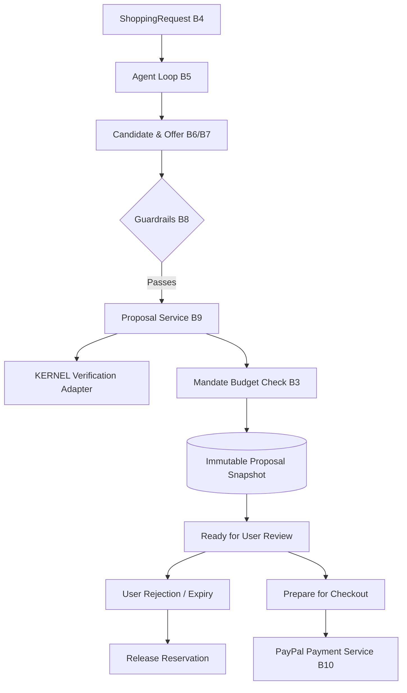

# CARTI — MODULE B9 IMPLEMENTATION REPORT
## Proposal Service and Retailer Verification

**Status:** COMPLETE (Definition of Done Met)  
**Date:** November 5, 2026  
**Module:** B9 — Proposal Service and Retailer Verification  
**Author:** Senior Backend Architect, Financial Systems Auditor, QA Lead  
**Branch:** `vatsal`  
**Test Suite:** 28 B9 tests passed (220 total tests passed, 0 failures)

---

## 1. Executive Summary & Architecture Overview

Module B9 establishes the authoritative bridge between the candidate discovery & ranking pipeline (B4, B5, B6, B7, B8) and the financial checkout pipeline (B10 PayPal Payment Service). It is responsible for creating immutable purchase proposal snapshots from eligible candidates, calculating exact monetary totals using Python `Decimal` and PostgreSQL `NUMERIC`, verifying retailer domains and offer attributes, snapshotting product attributes and active mandate versions, enforcing deterministic guardrails, and safely preparing validated context for PayPal sandbox orders without granting LLMs or browsers payment authority.



---

## 2. Proposal Data Model

The proposal data model (`server/app/models/proposal.py`) was enhanced to guarantee complete immutability, exact monetary precision, and non-repudiable auditability:

| Column | Type | Nullable | Default | Description |
|---|---|---|---|---|
| `id` | UUID (PK) | No | `uuid4` | Unique proposal identifier |
| `request_id` | UUID (FK) | No | - | Cascade foreign key to `requests.id` |
| `user_id` | UUID (FK) | No | - | Cascade foreign key to `users.id` |
| `mandate_id` | UUID (FK) | No | - | Restrict foreign key to `mandates.id` |
| `mandate_version` | Integer | No | `1` | Exact version snapshot of the active mandate |
| `candidate_id` | UUID (FK) | No | - | Restrict foreign key to `candidates.id` |
| `offer_id` | UUID (FK) | No | - | Restrict foreign key to `candidate_offers.id` |
| `quantity` | Integer | No | `1` | Purchased item quantity (within mandate limit) |
| `unit_price_at_proposal` | Numeric(12, 2) | No | - | Exact unit price of retailer offer at creation |
| `subtotal_at_proposal` | Numeric(12, 2) | No | - | Calculated `unit_price * quantity` |
| `shipping_amount` | Numeric(12, 2) | No | `0.00` | Verified shipping cost (server-side only) |
| `tax_amount` | Numeric(12, 2) | No | `0.00` | Verified tax cost (server-side only) |
| `total_amount` | Numeric(12, 2) | No | `0.00` | Exact payable total (`subtotal + shipping + tax`) |
| `currency` | String(3) | No | `USD` | ISO 4217 3-letter currency code |
| `rationale` | Text | No | - | Ranking/selection explanation for user review |
| `guardrail_result` | JSON | No | `{}` | Complete snapshot of deterministic check outcomes |
| `verification_result` | JSON | Yes | `None` | Raw verification evidence, session ID, timestamps |
| `verification_status` | String(32) | No | `unverified` | `verified`, `mismatch`, `inconclusive`, `disabled` |
| `product_snapshot` | JSON | Yes | `{}` | Frozen title, brand, category, image, attributes |
| `offer_snapshot` | JSON | Yes | `{}` | Frozen domain, URL, price, availability, condition |
| `status` | String(32) | No | `pending` | `pending`, `checkout_started`, `rejected`, `expired`, `stale`, `invalidated` |
| `expires_at` | DateTime(tz) | No | - | Timezone-aware expiration timestamp (24h default) |
| `created_at` | DateTime(tz) | No | `now()` | Timezone-aware creation timestamp |
| `updated_at` | DateTime(tz) | No | `now()` | Timezone-aware modification timestamp |

---

## 3. Proposal Creation Flow

The central proposal creation method `ProposalService.create_proposal` executes in a strictly sequential, transactional pipeline:

1. **Ownership & Request Integrity:** Loads `ShoppingRequest` and ensures `request.user_id == authenticated_user_id`. Verifies request is not cancelled, completed, or failed.
2. **Candidate Boundary Validation:** Ensures `candidate.request_id == request.id` to prevent cross-request or cross-user candidate injection.
3. **Offer Verification:** Confirms selected retailer offer belongs to the candidate, is marked `is_eligible == True`, and availability is not out of stock.
4. **Mandate Version Snapshot:** Retrieves the user's spending mandate through B3, confirms it is in active status, not expired or revoked, and snapshots `mandate.version`.
5. **Guardrail Enforcement:** Verifies quantity is within `mandate.max_quantity_per_product`, category is permitted and not blocked, retailer domain is allowed, offer currency strictly equals mandate currency, and unit price does not exceed `mandate.per_item_cap`.
6. **Decimal Price Calculation:** Computes `subtotal = unit_price * quantity` and `total = subtotal + shipping + tax` with exact 2-decimal precision.
7. **Available Budget Row-Level Locking:** Executes `mandate_service.calculate_available_budget(mandate.id, lock_row=True)`. Blocks proposal creation with `BUDGET_EXCEEDED` if `total_amount > available_budget`.
8. **Retailer & KERNEL Verification:** Executes `KernelVerificationService.verify_retailer_offer(...)` validating retailer domain and inspecting page data.
9. **Idempotency Guard:** Checks for existing pending proposal matching `(request_id, candidate_id, offer_id)` to prevent race-condition duplicates.
10. **Persistence & Audit:** Flushes proposal snapshot and logs non-repudiable audit event `proposal_created`.

---

## 4. Mandate and Guardrail Integration (B3 & B8)

- **Mandate Invariance:** When a user updates their mandate, prior proposals retain the historical `mandate_version` under which they were authorized.
- **Budget Reservations:** B9 calculates available budget through B3 using row-level locks (`SELECT ... FOR UPDATE` on PostgreSQL). In-flight order reservations and captured spend are strictly deducted.
- **Reservation Release on Rejection/Expiry:** When a user rejects a proposal or it expires, any reserved order amount is immediately returned to the mandate via `mandate_service.release_budget_reservation(order_id, reason)`.

---

## 5. Retailer Offer Verification & KERNEL Adapter

Implemented in `server/app/services/kernel_service.py`:
- **Strict Domain Allowlist:** Parses and normalizes offer URL hostnames. Prevents navigation or redirects to unauthorized domains.
- **Zero Payment Authority:** KERNEL is strictly a read-only browser inspection mechanism. It possesses zero credentials, zero payment authority, and never interacts with checkout forms or purchase buttons.
- **Untrusted Page Content:** Page text is treated as hostile untrusted input; extracted values are strictly sanitized and never piped into LLM instruction prompts.
- **Safe Status Reporting:** When disabled (`settings.KERNEL_ENABLED = False`), it cleanly reports `status="disabled"` without fabricating verification outcomes. When enabled and price or availability deviates, it marks `status="mismatch"`.

---

## 6. Price Calculation Methodology

- Zero floating-point arithmetic. All monetary values use Python `Decimal` and PostgreSQL `NUMERIC(12, 2)`.
- Client requests cannot submit prices, amounts, subtotals, or currencies. All values are sourced directly from validated server-side offers.
- Unknown shipping and tax default to `0.00` and are clearly segregated from item subtotal.

---

## 7. Proposal Lifecycle & State Machine

```
              ┌─────────────► checkout_started ─────────────► ordered / completed
              │
pending ──────┼─────────────► rejected (releases reservation)
              │
              ├─────────────► expired (auto-sweep on access or batch)
              │
              └─────────────► stale / invalidated (on price/stock change)
```

- **Rejection:** `POST /api/proposals/{id}/reject` transitions status to `rejected` and releases in-flight order budget reservations.
- **Automatic Expiration:** Inquiries via `get_proposal` or `get_proposals_for_request` evaluate `expires_at <= utc_now()` and update status to `expired`.
- **Batch Sweeper:** `expire_old_proposals()` provides batch expiration for background workers.
- **Terminal State Protection:** Terminal states (`ordered`, `completed`) cannot be rejected, reopened, or overwritten.

---

## 8. Checkout Preparation Boundary (B9 -> B10)

`prepare_proposal_for_checkout(proposal_id, user_id)` produces a trusted `CheckoutPreparationResult` consumable by B10 (PayPal Payment Service):
- Validates user ownership.
- Ensures proposal is in strictly `pending` status.
- Confirms proposal has not expired.
- Re-checks that mandate is active, not revoked, and currency matches.
- Refreshes offer eligibility and stock status.
- Re-locks mandate and confirms `total_amount <= available_budget`.
- B9 never calls PayPal APIs directly, never captures payments, and never refunds transactions.

---

## 9. API Changes

Enhanced `server/app/api/routes/proposals.py`:
- `GET /api/proposals?request_id={uuid}`: List all proposals for an authenticated user's shopping request.
- `GET /api/proposals/{proposal_id}`: Load immutable proposal snapshot, product attributes, and retailer offer summary.
- `POST /api/proposals`: Create a proposal from candidate and offer.
- `POST /api/proposals/{proposal_id}/reject`: User rejection endpoint with optional reason.
- `POST /api/proposals/{proposal_id}/order`: PayPal Sandbox order creation delegation to B10.

---

## 10. Database Migrations

- Created Alembic migration `server/app/db/migrations/versions/f2b8c9d01e34_add_b9_proposal_fields_and_snapshots.py`.
- Head revision: `f2b8c9d01e34`.
- Uses `batch_alter_table` for full SQLite and PostgreSQL compatibility.
- Adds `mandate_version`, `shipping_amount`, `tax_amount`, `total_amount`, `product_snapshot`, `offer_snapshot`, `verification_status`, `updated_at`, and index `ix_proposals_request_status`.

---

## 11. Security & IDOR Verification

- **Multi-Tenant Isolation:** User B attempting to read, reject, or prepare checkout for User A's proposal receives `403 ACCESS_DENIED`.
- **Cross-Resource Tampering:** Rejects candidates belonging to other requests, mandates belonging to other users, and offers belonging to other candidates.
- **Client Price Forgery Prevention:** All endpoints reject client-supplied financial amounts.

---

## 12. Automated Test Results

The comprehensive test suite `server/tests/test_b9_proposals.py` was executed alongside the full regression suite:

```
============================= test session starts =============================
platform win32 -- Python 3.14.3, pytest-9.2.0, pluggy-1.7.0
collected 220 items

server\tests\test_auth.py ..............                                 [  6%]
server\tests\test_b2_security_audit.py ......................            [ 16%]
server\tests\test_b3_financial_audit.py ...........                      [ 21%]
server\tests\test_b4_lifecycle.py .............                          [ 27%]
server\tests\test_b4_orchestration.py .................                  [ 35%]
server\tests\test_b5_agent_loop.py ...................................   [ 50%]
server\tests\test_b9_proposals.py ............................           [ 63%]
server\tests\test_candidates.py ..                                       [ 64%]
server\tests\test_health.py ..                                           [ 65%]
server\tests\test_mandates.py ...                                        [ 66%]
server\tests\test_mandates_b3.py .....................................   [ 83%]
server\tests\test_orders.py ...                                          [ 85%]
server\tests\test_ownership_b2.py .......                                [ 88%]
server\tests\test_proposals.py ....                                      [ 90%]
server\tests\test_rate_limit_and_payloads.py ..                          [ 90%]
server\tests\test_requests.py .....                                      [ 93%]
server\tests\test_security_and_edge_cases.py .............               [ 99%]
server\tests\test_webhooks.py ..                                         [100%]

======================= 220 passed, 1 warning in 22.54s =======================
```

- **B9 New Tests:** 28 passed (Sections A through I).
- **Regression Tests:** 192 passed.
- **Failures:** 0.

---

## 13. Definition of Done Checklist

- [x] Proposal creation works through central service (`ProposalService.create_proposal`).
- [x] Authenticated ownership is enforced (IDOR defense).
- [x] Correct mandate versions are snapshotted and preserved.
- [x] Deterministic guardrails (B8) are strictly enforced.
- [x] Retailer offers and domains are validated.
- [x] Monetary calculations use Python `Decimal` and PostgreSQL `NUMERIC`.
- [x] Proposal product and offer snapshots are persisted immutably.
- [x] Budget availability is checked with row-level locks via B3.
- [x] Duplicate proposal creation is idempotent.
- [x] Proposal lifecycle transitions (`pending`, `checkout_started`, `rejected`, `expired`, `stale`) are enforced.
- [x] Automatic expiration and reservation release work.
- [x] Checkout preparation (`prepare_proposal_for_checkout`) revalidates facts for B10.
- [x] B10 payment boundaries are strictly respected (zero payment operations in B9).
- [x] KERNEL verification status is accurately reported without fabrication.
- [x] API routes are functional and OpenAPI documented.
- [x] Audit events (`proposal_created`, `proposal_rejected`, `proposal_expired`, `checkout_prepared`) are recorded.
- [x] 28/28 new B9 tests pass.
- [x] 220/220 full test suite passes with zero regressions.
- [x] Git branch `vatsal` updated; `main` branch completely untouched.
